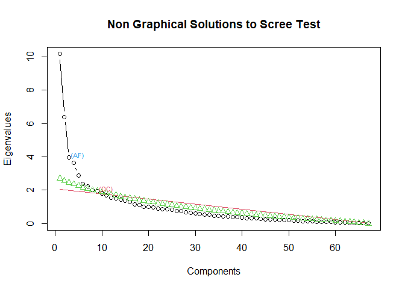
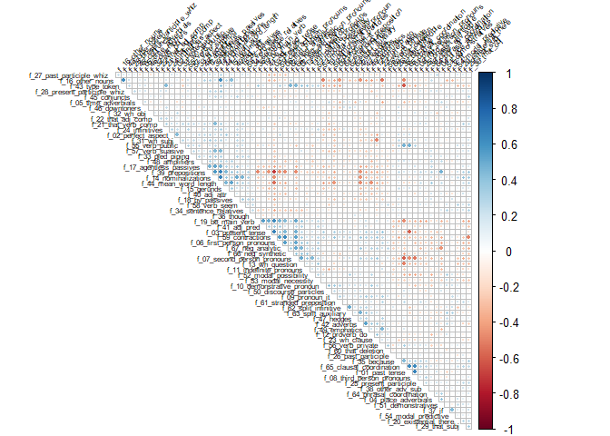
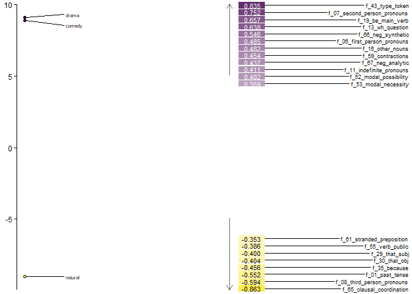
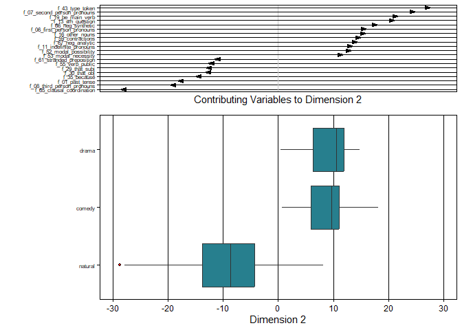

# Dramaticity Pipeline
Zach Shultz
2026-11-06

## EXISTING

This pipeline was used for progress report 2, it has been updated to
reflect the final analysis

## Prereqs

In addition to tidyverse packages, `corrplot`, `mda.biber`, and `polars`
will all be needed. Polars is a special, relatively new type of data
frame often used in python. This package is only necessary for
transforming data frames so that python can use them properly.

Additionally, an installation of python (3.10+), pandas, NumPy, and
spaCy is required to complete the process described below. Once these
are installed, everything can be completed within R as described below.

[Information on python side](https://browndw.github.io/pybiber/)

[Information on spaCy](https://spacy.io/usage)

``` r
library(tidyverse)
```

    ── Attaching core tidyverse packages ──────────────────────── tidyverse 2.0.0 ──
    ✔ dplyr     1.2.1     ✔ readr     2.2.0
    ✔ forcats   1.0.1     ✔ stringr   1.6.0
    ✔ ggplot2   4.0.3     ✔ tibble    3.3.1
    ✔ lubridate 1.9.5     ✔ tidyr     1.3.2
    ✔ purrr     1.2.2     
    ── Conflicts ────────────────────────────────────────── tidyverse_conflicts() ──
    ✖ dplyr::filter() masks stats::filter()
    ✖ dplyr::lag()    masks stats::lag()
    ℹ Use the conflicted package (<http://conflicted.r-lib.org/>) to force all conflicts to become errors

``` r
library(corrplot)
```

    corrplot 0.95 loaded

``` r
library(mda.biber)
library(polars)
```

## Intro

This pipeline describes the process of completing the MDA. See the
[Santa Barbara Pipeline](santa_barbara_pipeline.md) and the [Scraps from
the Loft Pipeline](scraps_from_loft_pipeline.md) for information on how
the component data frames were assembled and where the data came from.

This document is used to describe how the individual data frames were
combined, the shape of the resulting data frame, and the steps of the
analysis. If more details are needed to explain the steps of the MDA,
see the [MDA document](mda.md). Final results and exploration of the
analysis is documented in the [Dramaticity Analysis](final_report.md)
document.

## Creating all_transcripts df

First, we load in the tv_show_transcripts pipeline as a csv (saved to
avoid repeated webscraping).

``` r
tv_show_df <- read.csv("private/tv_show_transcripts.csv")

tv_show_df
```

Then, we can load in the SB data frame.

``` r
sb_files <- read.csv("private/sb_files.csv")

sb_files
```

Finally, we combine the two data frames.

``` r
all_transcripts <- rbind(sb_files, tv_show_df)

all_transcripts <- all_transcripts|>
  #renaming the second column to text as that is what is expected for the pybiber pipeline below
  rename(text = "clean_words",
         doc_id = "id")
```

Now we save this file to our private folder!

``` r
write_csv(all_transcripts, "private/all_transcripts.csv")
```

## Summary all_transcripts

Below is some summary information about what is included in
all_transcripts:

Number of rows and columns in our df

``` r
nrow(all_transcripts)
```

    [1] 120

``` r
ncol(all_transcripts)
```

    [1] 2

Approximate number of words in our df:

``` r
all_transcripts |>
  mutate(nwords = (str_count(text, "\\w+"))) |>
  summarize(sum(nwords))
```

      sum(nwords)
    1      538726

Approximate number of words by category:

``` r
all_transcripts |>
  mutate(id = case_when(str_detect(doc_id, "trn") ~ "natural", 
                        str_detect(doc_id, "comedy") ~ "comedy", 
                        str_detect(doc_id, "drama") ~ "drama")) |>
  mutate(nwords = (str_count(text, "\\w+"))) |>
  group_by(doc_id) |>
  summarize(sum(nwords))
```

    # A tibble: 120 × 2
       doc_id                     `sum(nwords)`
       <chr>                              <int>
     1 9_1_1_drama                         5246
     2 a_man_on_the_inside_comedy          4111
     3 abbott_elementary_comedy            3390
     4 adults_comedy                       3314
     5 anna_pigeon_drama                   4850
     6 bad_monkey_drama                    7810
     7 beauty_in_black_drama               4678
     8 best_medicine_2026_comedy           6185
     9 boots_comedy                        3322
    10 breaking_bad_drama                  3353
    # ℹ 110 more rows

## Tagging all_transcripts and Getting Factor Loadings

Tagging the transcripts required a python package. This process was
first completed in an ipynb file, but it can also be run in cells within
R as is show below.

Here, spacy is being downloaded as this is the word parser we are using.
Pybiber is a python package that runs word parsing and compiles a count
of the (67 linguistic features developed by Biber)\[mda.md\]. Lastly,
polars is a type of data frame that pybiber utilizes.

``` python
#spacy word parsing
import spacy
#pybiber
import pybiber as pb
#polars data frames
import polars as pl
```

``` python
#loading the English word parsing from spacy
#note that Named Entity Recognition (ner) has been disabled as it is not required for Biber features
nlp = spacy.load("en_core_web_sm", disable=["ner"])
```

Below, we are reading in the csv we have created in R to python as a
polar.

``` python
#loading our df as a polar (pl)
all_transcripts = pl.read_csv("private/all_transcripts.csv")
```

``` python
#checking to see if we got the right df
all_transcripts.head()
```

    shape: (5, 2)
    ┌─────────┬─────────────────────────────────┐
    │ doc_id  ┆ text                            │
    │ ---     ┆ ---                             │
    │ str     ┆ str                             │
    ╞═════════╪═════════════════════════════════╡
    │ trn_001 ┆ So you don't need to go borrow… │
    │ trn_002 ┆ How can you teach a three-year… │
    │ trn_003 ┆ Okay. Do you have a particular… │
    │ trn_004 ┆ Juice anybody ? I like it, for… │
    │ trn_005 ┆ But, but to try and and talk m… │
    └─────────┴─────────────────────────────────┘

Above is what the polar document roughly looks like! We have
successfully tranformed our df into a polar.

Next, we will tag each word in each corpus with various information. As
a reminder, `nlp` below is simply the English word parser from spacy.

``` python
#creating the processor from pybiber
processor = pb.CorpusProcessor()
#running the processor on our new data frame with the process_corpus function from pybiber
df_dramaticity = processor.process_corpus(all_transcripts, nlp_model=nlp)
```

    Performance: Corpus processing completed in 87.40s

``` python
df_dramaticity.tail()
```

    shape: (5, 9)
    ┌───────────────┬─────────────┬──────────┬────────┬────────┬───────┬─────┬───────────────┬─────────┐
    │ doc_id        ┆ sentence_id ┆ token_id ┆ token  ┆ lemma  ┆ pos   ┆ tag ┆ head_token_id ┆ dep_rel │
    │ ---           ┆ ---         ┆ ---      ┆ ---    ┆ ---    ┆ ---   ┆ --- ┆ ---           ┆ ---     │
    │ str           ┆ u32         ┆ i64      ┆ str    ┆ str    ┆ str   ┆ str ┆ i64           ┆ str     │
    ╞═══════════════╪═════════════╪══════════╪════════╪════════╪═══════╪═════╪═══════════════╪═════════╡
    │ young_sheldon ┆ 386         ┆ 3032     ┆ listen ┆ listen ┆ VERB  ┆ VB  ┆ 3030          ┆ xcomp   │
    │ _comedy       ┆             ┆          ┆        ┆        ┆       ┆     ┆               ┆         │
    │ young_sheldon ┆ 386         ┆ 3033     ┆ to     ┆ to     ┆ PART  ┆ TO  ┆ 3034          ┆ aux     │
    │ _comedy       ┆             ┆          ┆        ┆        ┆       ┆     ┆               ┆         │
    │ young_sheldon ┆ 386         ┆ 3034     ┆ show   ┆ show   ┆ VERB  ┆ VB  ┆ 3032          ┆ advcl   │
    │ _comedy       ┆             ┆          ┆        ┆        ┆       ┆     ┆               ┆         │
    │ young_sheldon ┆ 386         ┆ 3035     ┆ tunes  ┆ tune   ┆ NOUN  ┆ NNS ┆ 3034          ┆ dobj    │
    │ _comedy       ┆             ┆          ┆        ┆        ┆       ┆     ┆               ┆         │
    │ young_sheldon ┆ 386         ┆ 3036     ┆ .      ┆ .      ┆ PUNCT ┆ .   ┆ 3030          ┆ punct   │
    │ _comedy       ┆             ┆          ┆        ┆        ┆       ┆     ┆               ┆         │
    └───────────────┴─────────────┴──────────┴────────┴────────┴───────┴─────┴───────────────┴─────────┘

Above, we can that it has taken each word and begun to tag it with the
relevant features. This is still essentially spaCy parsing.

Below is what the pybiber package really adds. The `pb.biber` function
below essentially counts the parsed text from above and assembles a
count of the 67 linguistic features form Biber.

``` python
#creating a new df that has a count of the features for each document
df_biber_dramaticity = pb.biber(df_dramaticity)
```

``` python
print(f"Matrix dimensions: {df_biber_dramaticity.shape}")
```

    Matrix dimensions: (120, 68)

``` python
df_biber_dramaticity.head()
```

    shape: (5, 68)
    ┌─────────┬─────────┬─────────┬─────────┬─────────┬───┬────────┬────────┬────────┬────────┬────────┐
    │ doc_id  ┆ f_01_pa ┆ f_02_pe ┆ f_03_pr ┆ f_04_pl ┆ … ┆ f_63_s ┆ f_64_p ┆ f_65_c ┆ f_66_n ┆ f_67_n │
    │ ---     ┆ st_tens ┆ rfect_a ┆ esent_t ┆ ace_adv ┆   ┆ plit_a ┆ hrasal ┆ lausal ┆ eg_syn ┆ eg_ana │
    │ str     ┆ e       ┆ spect   ┆ ense    ┆ erbials ┆   ┆ uxilia ┆ _coord ┆ _coord ┆ thetic ┆ lytic  │
    │         ┆ ---     ┆ ---     ┆ ---     ┆ ---     ┆   ┆ ry     ┆ inatio ┆ inatio ┆ ---    ┆ ---    │
    │         ┆ f64     ┆ f64     ┆ f64     ┆ f64     ┆   ┆ ---    ┆ n      ┆ n      ┆ f64    ┆ f64    │
    │         ┆         ┆         ┆         ┆         ┆   ┆ f64    ┆ ---    ┆ ---    ┆        ┆        │
    │         ┆         ┆         ┆         ┆         ┆   ┆        ┆ f64    ┆ f64    ┆        ┆        │
    ╞═════════╪═════════╪═════════╪═════════╪═════════╪═══╪════════╪════════╪════════╪════════╪════════╡
    │ 9_1_1_d ┆ 28.6201 ┆ 3.41167 ┆ 85.8605 ┆ 3.79075 ┆ … ┆ 2.6535 ┆ 1.8953 ┆ 8.5291 ┆ 1.7058 ┆ 16.679 │
    │ rama    ┆ 67      ┆ 6       ┆         ┆ 1       ┆   ┆ 25     ┆ 75     ┆ 89     ┆ 38     ┆ 303    │
    │ a_man_o ┆ 35.1429 ┆ 4.60494 ┆ 86.7668 ┆ 1.21182 ┆ … ┆ 2.4236 ┆ 0.9694 ┆ 11.391 ┆ 1.6965 ┆ 15.026 │
    │ n_the_i ┆ 96      ┆ 4       ┆ 44      ┆ 7       ┆   ┆ 55     ┆ 62     ┆ 178    ┆ 58     ┆ 66     │
    │ nside_c ┆         ┆         ┆         ┆         ┆   ┆        ┆        ┆        ┆        ┆        │
    │ omedy   ┆         ┆         ┆         ┆         ┆   ┆        ┆        ┆        ┆        ┆        │
    │ abbott_ ┆ 27.6796 ┆ 5.88928 ┆ 97.4676 ┆ 1.17785 ┆ … ┆ 4.4169 ┆ 1.4723 ┆ 13.839 ┆ 0.5889 ┆ 16.784 │
    │ element ┆ 23      ┆ 2       ┆ 09      ┆ 6       ┆   ┆ 61     ┆ 2      ┆ 812    ┆ 28     ┆ 452    │
    │ ary_com ┆         ┆         ┆         ┆         ┆   ┆        ┆        ┆        ┆        ┆        │
    │ edy     ┆         ┆         ┆         ┆         ┆   ┆        ┆        ┆        ┆        ┆        │
    │ adults_ ┆ 27.9111 ┆ 4.20168 ┆ 103.841 ┆ 2.10084 ┆ … ┆ 3.6014 ┆ 0.6002 ┆ 9.6038 ┆ 1.5006 ┆ 19.807 │
    │ comedy  ┆ 64      ┆ 1       ┆ 537     ┆         ┆   ┆ 41     ┆ 4      ┆ 42     ┆        ┆ 923    │
    │ anna_pi ┆ 39.2277 ┆ 5.75066 ┆ 92.4214 ┆ 3.28609 ┆ … ┆ 3.6968 ┆ 1.0269 ┆ 11.706 ┆ 1.0269 ┆ 18.689 │
    │ geon_dr ┆ 68      ┆ 7       ┆ 42      ┆ 6       ┆   ┆ 58     ┆ 05     ┆ 716    ┆ 05     ┆ 669    │
    │ ama     ┆         ┆         ┆         ┆         ┆   ┆        ┆        ┆        ┆        ┆        │
    └─────────┴─────────┴─────────┴─────────┴─────────┴───┴────────┴────────┴────────┴────────┴────────┘

Note that features have been normalized so that texts of different
lengths can be compared:

[“Most features: Normalized per 1,000 tokens, f_43_type_token:
Type-token ratio (0-1 scale), f_44_mean_word_length: Average characters
per word”](https://browndw.github.io/pybiber/get-started.html)

``` python
#write out the df as a csv document back into the private folder
df_biber_dramaticity.write_csv("private/df_biber_dramaticity")
```

## Getting Dimension Scores

Now, we can move that file back into R. As can be seen at the end of the
notebook, we wrote out a new csv file that contains the feature loadings
for each text These can now be run through the process to get the 67
linguistic features.

``` r
#reads in the csv file created in python
df_biber_dramaticity <- read.csv("private/df_biber_dramaticity")
```

Once read in, the process described
[here](https://cran.r-project.org/web/packages/mda.biber/vignettes/introduction.html)
is used to run our first attempt at the MDA. Note that this was created
by David Brown, a linguist at CMU!

Note that the documents are being renamed below such that each
individual file is represented by it’s category and no other
information. For instance, each comedy TV show will only be known as
comedy.

``` r
#ok so first we are assigning our data set to the variable d
d <- df_biber_dramaticity %>%
  #then, we are modifying a column called doc_id to rename columns that contain either "comedy", "drama" or "trn" with "comedy", "drama", and "natural". 
  mutate(doc_id = case_when(str_detect(doc_id, "comedy") ~ "comedy",
                            str_detect(doc_id, "drama") ~ "drama",
                            str_detect(doc_id, "trn") ~ "natural")) %>%
  #then we are modifying our new column so the strings are factors
  mutate(doc_id = as.factor(doc_id)) %>%
  #removes the columns with values = 0
  select(where(~ any(. != 0)))
```

This changes the labels of the id column so that our groups are formed,
turns them into factors, and removes any columns with 0 instances.

``` r
screeplot_mda(d)
```



A screeplot is used to determine the dimensions we want to keep in our
analysis. The ‘elbow’ is determined by AF. Anything at or below the
elbow is considered ‘scree’ and we do not want to include that in our
analysis. In this case, we should include two factors because their are
two points above the AF.

``` r
cor_m <- cor(d[,-1], method = "pearson")

corrplot(cor_m, type = "upper", order = "hclust", tl.col = "black", tl.srt = 45, diag = F, tl.cex = 0.5)
```



This plot is a representation of correlation between features. Blue
indicates positive correlation along and red indicates negative
correlation. We can see that a number of these features are correlated,
so an MDA analysis makes sense.

``` r
#now for the actual mda, factors is set equal to 2 because of the screeplot results
m <- mda_loadings(d, n_factors = 2)
```

``` r
attributes(m)$group_means
```

        group    Factor1   Factor2
    1  comedy -0.1310452  8.904092
    2   drama  3.2968505  9.107540
    3 natural -1.6971658 -9.012598

``` r
#values arranged in descending order for factor 1
attributes(m)$loadings %>% arrange(-Factor1)
```

                                      Factor1       Factor2
    f_44_mean_word_length         0.947029968  0.1614759798
    f_16_other_nouns              0.802337549  0.4821839105
    f_39_prepositions             0.672637182 -0.3324764024
    f_14_nominalizations          0.635930433 -0.0675856113
    f_43_type_token               0.545446931  0.8349914572
    f_40_adj_attr                 0.521984516  0.0559025913
    f_17_agentless_passives       0.506923224 -0.1306728132
    f_15_gerunds                  0.465063357 -0.0890153235
    f_57_verb_suasive             0.436280577  0.1165418567
    f_18_by_passives              0.400383967 -0.0816136811
    f_28_present_participle_whiz  0.390389260  0.1191362365
    f_24_infinitives              0.384409700  0.2782185099
    f_64_phrasal_coordination     0.339438817 -0.1417959278
    f_31_wh_subj                  0.300639350 -0.0656767400
    f_27_past_participle_whiz     0.295820490 -0.0356840412
    f_58_verb_seem                0.289087692  0.0005591014
    f_02_perfect_aspect           0.284041642 -0.0012683244
    f_33_pied_piping              0.282537969 -0.0848695028
    f_48_amplifiers               0.260380835 -0.1727451770
    f_21_that_verb_comp           0.259202084 -0.1088919959
    f_51_demonstratives           0.216416336 -0.2845504099
    f_46_downtoners               0.215803960  0.1145631869
    f_30_that_obj                 0.203284981 -0.4041010682
    f_45_conjuncts                0.201164008 -0.0689037860
    f_34_sentence_relatives       0.195012340 -0.2770451067
    f_66_neg_synthetic            0.169081320  0.5464174271
    f_13_wh_question              0.128454242  0.6383615808
    f_29_that_subj                0.112831367 -0.4004347469
    f_25_present_participle       0.101547180 -0.3446392097
    f_36_though                   0.095222863 -0.0934556791
    f_05_time_adverbials          0.094489138  0.2421127203
    f_22_that_adj_comp            0.083985959 -0.0001587179
    f_11_indefinite_pronouns      0.065936541  0.4108159274
    f_32_wh_obj                   0.058344856 -0.0396800938
    f_35_because                  0.040342280 -0.4561336031
    f_04_place_adverbials         0.036745359 -0.1403274576
    f_38_other_adv_sub            0.004728748 -0.3192987447
    f_26_past_participle         -0.002172071 -0.1910985150
    f_55_verb_public             -0.022034507 -0.3860743504
    f_20_existential_there       -0.030834687 -0.3479457911
    f_52_modal_possibility       -0.061955786  0.4017925355
    f_37_if                      -0.072248320 -0.1019397370
    f_53_modal_necessity         -0.074992469  0.3594390441
    f_19_be_main_verb            -0.130810692  0.6567576027
    f_41_adj_pred                -0.134270117  0.3133075556
    f_54_modal_predictive        -0.142023392 -0.0832874135
    f_01_past_tense              -0.152861229 -0.5518688533
    f_07_second_person_pronouns  -0.157915408  0.7519147774
    f_62_split_infinitive        -0.158588054  0.0652977239
    f_08_third_person_pronouns   -0.166527075 -0.5938586496
    f_60_that_deletion           -0.187480630  0.0728037248
    f_47_hedges                  -0.216472288 -0.1062592689
    f_06_first_person_pronouns   -0.238037634  0.4847065996
    f_63_split_auxiliary         -0.255305795  0.1038317372
    f_65_clausal_coordination    -0.338855140 -0.8627515914
    f_61_stranded_preposition    -0.344493497 -0.3528803567
    f_67_neg_analytic            -0.351718850  0.4370736797
    f_23_wh_clause               -0.384119001  0.1985267767
    f_50_discourse_particles     -0.390867530 -0.2393332349
    f_03_present_tense           -0.394374366  0.3381849116
    f_56_verb_private            -0.477229653 -0.2237540733
    f_12_proverb_do              -0.499715243 -0.0021616785
    f_10_demonstrative_pronoun   -0.505938649 -0.1372157884
    f_49_emphatics               -0.515504172 -0.0564564415
    f_42_adverbs                 -0.552485513  0.0441813688
    f_09_pronoun_it              -0.583422593 -0.2079839617
    f_59_contractions            -0.603019105  0.4543705585

## Creating Dimensions

From these values, we can now create our dimensions. We do this by
compiling the relevant factors for each dimension (\>.35 0r \>-.35)

``` r
stickplot_mda(m, n_factor = 2)
```


Not a very exciting graph with only a binary comparison!

``` r
heatmap_mda(m, n_factor = 2)
```



This is a bit more telling. Interesting that emphatics appear to predict
natural discourse here when compared to TV show dialogue. I hypothesized
it might be the opposite.

``` r
boxplot_mda(m, n_factor = 2)
```



Last graph. Similar to the last one, this is just a measure of how
different these document types are. Worth noting that the natural
discourses varied a **lot** more and had several outliers.

## Running MDA with Comedy-Drama Distinction

## Considering Relevant Features

``` r
sessionInfo()
```

    R version 4.6.1 (2026-06-24 ucrt)
    Platform: x86_64-w64-mingw32/x64
    Running under: Windows 11 x64 (build 26200)

    Matrix products: default
      LAPACK version 3.12.1

    locale:
    [1] LC_COLLATE=English_United States.utf8 
    [2] LC_CTYPE=English_United States.utf8   
    [3] LC_MONETARY=English_United States.utf8
    [4] LC_NUMERIC=C                          
    [5] LC_TIME=English_United States.utf8    

    time zone: America/New_York
    tzcode source: internal

    attached base packages:
    [1] stats     graphics  grDevices utils     datasets  methods   base     

    other attached packages:
     [1] polars_2.0.0    mda.biber_1.0.1 corrplot_0.95   lubridate_1.9.5
     [5] forcats_1.0.1   stringr_1.6.0   dplyr_1.2.1     purrr_1.2.2    
     [9] readr_2.2.0     tidyr_1.3.2     tibble_3.3.1    ggplot2_4.0.3  
    [13] tidyverse_2.0.0

    loaded via a namespace (and not attached):
     [1] gtable_0.3.6       xfun_0.60          ggrepel_0.9.8      rstatix_1.1.0     
     [5] lattice_0.22-9     tzdb_0.5.0         vctrs_0.7.3        tools_4.6.1       
     [9] generics_0.1.4     parallel_4.6.1     pkgconfig_2.0.3    Matrix_1.7-5      
    [13] RColorBrewer_1.1-3 S7_0.2.2           nFactors_2.4.1.2   lifecycle_1.0.5   
    [17] compiler_4.6.1     farver_2.1.2       carData_3.0-6      htmltools_0.5.9   
    [21] yaml_2.3.12        Formula_1.2-6      car_3.1-5          pillar_1.11.1     
    [25] ggpubr_1.0.0       crayon_1.5.3       MASS_7.3-65        viridis_0.6.5     
    [29] abind_1.4-8        tidyselect_1.2.1   digest_0.6.39      stringi_1.8.9     
    [33] labeling_0.4.3     cowplot_1.2.0      fastmap_1.2.0      grid_4.6.1        
    [37] cli_3.6.6          magrittr_2.0.5     utf8_1.2.6         broom_1.0.13      
    [41] withr_3.0.3        backports_1.5.1    scales_1.4.0       bit64_4.8.4       
    [45] timechange_0.4.0   rmarkdown_2.31     bit_4.6.0          otel_0.2.0        
    [49] reticulate_1.46.0  gridExtra_2.3.1    ggsignif_0.6.4     png_0.1-9         
    [53] hms_1.1.4          evaluate_1.0.5     knitr_1.51         viridisLite_0.4.3 
    [57] rlang_1.3.0        Rcpp_1.1.2         glue_1.8.1         rstudioapi_0.19.0 
    [61] vroom_1.7.1        jsonlite_2.0.0     R6_2.6.1          
