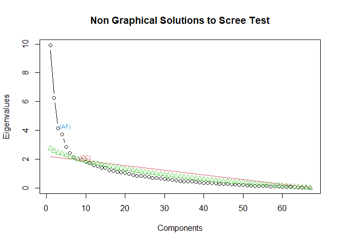
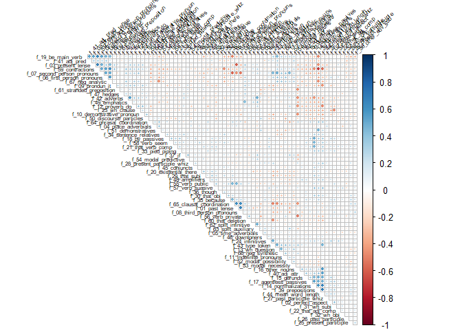
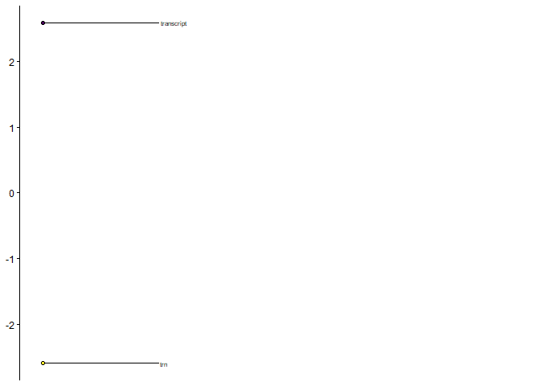
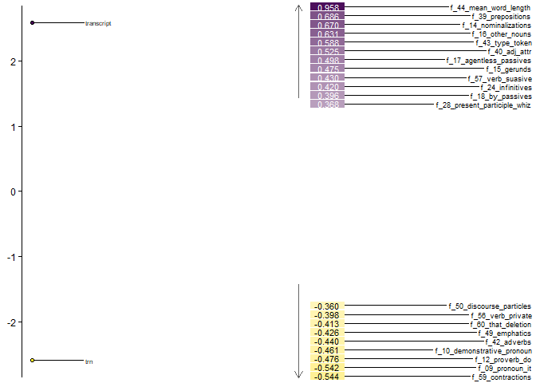
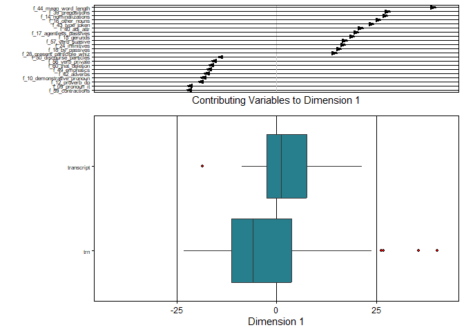

# Dramaticity Pipeline
Zach Shultz
2026-11-06

## Prereqs

``` r
library(tidyverse)
```

    ── Attaching core tidyverse packages ──────────────────────── tidyverse 2.0.0 ──
    ✔ dplyr     1.2.1     ✔ readr     2.2.0
    ✔ forcats   1.0.1     ✔ stringr   1.6.0
    ✔ ggplot2   4.0.3     ✔ tibble    3.3.1
    ✔ lubridate 1.9.5     ✔ tidyr     1.3.2
    ✔ purrr     1.2.2     
    ── Conflicts ────────────────────────────────────────── tidyverse_conflicts() ──
    ✖ dplyr::filter() masks stats::filter()
    ✖ dplyr::lag()    masks stats::lag()
    ℹ Use the conflicted package (<http://conflicted.r-lib.org/>) to force all conflicts to become errors

``` r
library(rvest)
```

    Attaching package: 'rvest'

    The following object is masked from 'package:readr':

        guess_encoding

``` r
library(corrplot)
```

    corrplot 0.95 loaded

``` r
library(mda.biber)
library(polars)
```

## Intro

This pipeline describes the process of completing the analysis. See the
[Santa Barbara Pipeline](santa_barbara_pipeline.md) and the [Scraps from
the Loft Pipeline](scraps_from_loft_pipeline.md) for information on how
the component data frames were assembled and where the data came from.

This document is used to describe how the individual data frames were
combined, the shape of the resulting data frame, and the steps of the
analysis. Final results and exploration of the analysis is documented in
the [Dramaticity Analysis](dramaticity_analysis.md) document.

## Creating all_transcripts df

First, we load in the tv_show_transcripts pipeline as a csv (saved to
avoid repeated webscraping).

``` r
tv_show_df <- read.csv("private/tv_show_transcripts.csv")

tv_show_df
```

Then, we can recreate the SB data frame with the code described in the

``` r
#creating a function to get the cleaned up words into a data frame all together
get_clean_wrds <- function(file) {

#reading in a file as a data frame

trn <- str_extract(file, "\\d+")
  
trn_df <-  read_delim(file, delim = "\t", col_names = FALSE)
#read in a file as a df

columns <- ncol(trn_df)
#ok we're trying something much simpler than we had before. At this point the pattern can be described as "select a column number equal to the number of columns because we always want the last column. So if we just get ourselves that variable and then just select that, we should be fine

trn_wrds <- trn_df |>
  select(words = columns)

# Function Definitions

#repetitions takes a given string and multiplies it by numbers that surround the string
repetitions <- function(string) {
  group <- string |>
  str_extract_all("([1-9])[^X]*\\1")
  #find the pattern we're looking for
  times <- group |>
  str_extract("[1-9]")
  #figure out the marking of how many times it should occur
  times <- as.numeric(times)
  #turn that marking into an actual number
  multiple <- strrep(group, times)
  #multiply that string by the multiple
  group <- string |>
  str_extract_all("([1-9])[^X]*\\1")
  #redefine the pattern we're looking for because group had to be renamed before (this is probably redundant but I'm confused rn so I don't wanna figure out the better way)
  string |>
    str_replace_all("([1-9])[^X]*\\1", multiple)
  #replace the initial string with what we want
}
enact_repeats <- function(string) {
  if_else(str_detect(string, "([1-9])[^X]*\\1"), repetitions(string), string)
}
#enact_repeats finds strings surrounded by numbers and enacts repetitions function (explained above)
clean <- function(string) {
  string |>
  str_replace_all("\x92", "'") |>
  #replaces a very specific unicode symbol with apostrophe's because ONE of the files uses this
  str_replace_all("[1-9]X+[1-9]", "") |>
  #before anything, get rid of the #X# combinations cause that causes problems
  enact_repeats()|>
  str_replace_all("\\([^)]*\\)", "") |>
  #replace a ( followed by any number of any characters but a ) and then a )
  str_replace_all("<[^ ]*", "") |>
  #replace any < followed by any number of characters but space
  str_replace_all("[^ ]*>", "") |>
  #replace any number of characters but a space immediately before a >
  str_replace_all("_. |_", " ") |>
  #replace an underscore followed by a single character or an underscore by itself
  str_replace_all("~[^ ]*", "") |>
  #replace a tilde followed by any character but a space with an empty string
  str_remove_all("[\\[\\]+%@=*X\\)\\(]") |>
  #remove each of the symbols inside, all of them
  str_remove_all("\\.\\.+") |>
  #remove two or more literal dots, all of them
  str_replace_all("!(\\w)", "\\1") |>
  str_remove_all("--+") |>
  #remove two or more dashes, all of them
  str_replace_all("^ | $", "") |>
  #remove all spaces at the beginning or end of the line
  str_replace_all("[1-9]", " ") |>
  #removes numbers
  str_replace_all("[ ]+", " ") |>
  #replace any space larger than one spaces with single spaces
  str_replace_all(" \\.", "\\.") |>
  str_replace_all(" \\,", "\\,") 
  #replaces any space before a period or comma with no space
}
#clean cleans up a data frame column made up of transcription markings to make it as close as possible to only dialogue. 

#Using clean() to clean up a data frame

clean_trn_wrds <- trn_wrds |>
  mutate(clean_words = clean(words))

#Getting the rows of dialogue into a single cell of dialogue

trn_text <- clean_trn_wrds |>
  select(!words) |>
  #get rid of messy version of each line
  mutate(clean_words = trimws(clean_words)) |>
  #trim white space 
  filter(!clean_words == '') |>
  #filter out empty lines
  mutate(trn = "x",
         .before = clean_words)
  #add a column fill in for unifying these features

trn_text <- trn_text |>
  summarize(clean_words = str_flatten(clean_words, " "))
  #returns a single cell data frame of all of the dialogue combined with spaces

trn_df <- trn_text |>
  mutate(id = str_flatten(c("trn", trn), "_"),
         .before = "clean_words")

trn_df
}
```

``` r
files = list.files("SBCorpus/TRN", full.names = TRUE)
#here we go into the file TRN and pull out all of the full names for the files
files
```

``` r
list_files <- files |>
  map(get_clean_wrds) 

all_files <- do.call(rbind, list_files)

all_files
```

Finally, we combine the two data frames.

``` r
all_transcripts <- rbind(all_files, tv_show_df)

all_transcripts
view(all_transcripts)
```

## Summary all_transcripts df

## Tagging all_transcripts

Tagging the transcripts required a python package. This process was
completed in an ipynb file which will be embedded for reference below.
It took substantial time to get the embedding to work and to get the
proper data frame types to move between r and python. Specifically, the
python package requires polar data frame types.

<div class="quarto-embed-nb-cell"
data-notebook="C:\Users\justz\Dramaticity-Multidimensional-Analysis\private\biber_analysis_condensed.ipynb"
data-notebook-cellId="cell-importing">

``` python
#spacy word parsing
import spacy
#the pybiber code
import pybiber as pb
#polars
import polars as pl
```

``` python
import sys
print(sys.executable)
```

    C:\ProgramData\anaconda3\python.exe

``` python
nlp = spacy.load("en_core_web_sm")
```

``` python
nlp = spacy.load("en_core_web_sm", disable=["ner"])
#getting the processing techniques
```

``` python
#loading our df
all_transcripts = pl.read_csv("all_transcripts.csv")
```

``` python
#checking to see if we got our df
all_transcripts.head()
```

<div><style>
.dataframe > thead > tr,
.dataframe > tbody > tr {
  text-align: right;
  white-space: pre-wrap;
}
</style>
<small>shape: (5, 2)</small>

| doc_id    | text                             |
|-----------|----------------------------------|
| str       | str                              |
| "trn_001" | "So you don't need to go borrow… |
| "trn_002" | "How can you teach a three-year… |
| "trn_003" | "Okay. Do you have a particular… |
| "trn_004" | "Juice anybody anybody ? I like… |
| "trn_005" | "But, but to try and and talk m… |

</div>

``` python
#defining processor and processing our df
processor = pb.CorpusProcessor()
df_dramaticity = processor.process_corpus(all_transcripts, nlp_model=nlp)
```

    Performance: Corpus processing completed in 99.13s

``` python
#creating biber tagged df
df_biber_dramaticity = pb.biber(df_dramaticity)
```

``` python
print(f"Matrix dimensions: {df_biber_dramaticity.shape}")
df_biber_dramaticity.head()
```

    Matrix dimensions: (120, 68)

<div><style>
.dataframe > thead > tr,
.dataframe > tbody > tr {
  text-align: right;
  white-space: pre-wrap;
}
</style>
<small>shape: (5, 68)</small>

| doc_id | f_01_past_tense | f_02_perfect_aspect | f_03_present_tense | f_04_place_adverbials | … | f_63_split_auxiliary | f_64_phrasal_coordination | f_65_clausal_coordination | f_66_neg_synthetic | f_67_neg_analytic |
|----|----|----|----|----|----|----|----|----|----|----|
| str | f64 | f64 | f64 | f64 | … | f64 | f64 | f64 | f64 | f64 |
| "9_1_1_transcript" | 28.620167 | 3.411676 | 85.8605 | 3.790751 | … | 2.653525 | 1.895375 | 8.529189 | 1.705838 | 16.679303 |
| "a_man_on_the_inside_transcript" | 35.066505 | 4.594921 | 86.577993 | 1.20919 | … | 2.41838 | 0.967352 | 11.366385 | 1.692866 | 14.993954 |
| "abbott_elementary_transcript" | 27.679623 | 5.889282 | 97.467609 | 1.177856 | … | 4.416961 | 1.47232 | 13.839812 | 0.588928 | 16.784452 |
| "adults_transcript" | 27.911164 | 4.201681 | 103.841537 | 2.10084 | … | 3.601441 | 0.60024 | 9.603842 | 1.5006 | 19.807923 |
| "anna_pigeon_transcript" | 39.227768 | 5.750667 | 92.421442 | 3.286096 | … | 3.696858 | 1.026905 | 11.706716 | 1.026905 | 18.689669 |

</div>

``` python
df_biber_dramaticity.write_csv("df_biber_dramaticity")
```

</div>

## Getting 67 Features

Now, we can move that file back into R. As can b seen at the end of the
notebook, we write out a new csv file that contains the tagged words.
These can now be run through the process to get the 67 linguistic
features.

``` r
#reads in the csv file created in the notebook
df_biber_dramaticity <- read.csv("private/df_biber_dramaticity")
```

Once read in, the process described
[here](https://cran.r-project.org/web/packages/mda.biber/vignettes/introduction.html)
is used to run our first attempt at the mda.

It is worth noting that at this point, this is more of a test analysis
in order to get a better idea of how the process works and be able to
work backwards to understand how to improve the process.

``` r
#ok so first we are assigning our data set to the variable d
d <- df_biber_dramaticity %>%
  #then, we are modifying a column called doc_id to extract strings that are either transcript or trn for their respective data sources
  mutate(doc_id = if_else(str_detect(doc_id, "transcript"), str_extract(doc_id, "transcript"), str_extract(doc_id, "trn"))) %>%
  #then we are modifying our new column so the strings are factors
  mutate(doc_id = as.factor(doc_id)) %>%
  #this is identifying only the columns that aren't 0?
  select(where(~ any(. != 0)))
```

This changes the labels of the id column so that our groups are formed,
turns them into factors, and removes any columns with 0 instances.

``` r
screeplot_mda(d)
```



A screeplot is used to determine the dimensions we want to keep in our
analysis. The ‘elbow’ is determined by AF. Anything at or below the
elbow is considered ‘scree’ and we do not want to include that in our
analysis. In this case, we should include two factors because their are
two points above the AF.

``` r
cor_m <- cor(d[,-1], method = "pearson")

corrplot(cor_m, type = "upper", order = "hclust", tl.col = "black", tl.srt = 45, diag = F, tl.cex = 0.5)
```



This plot is a representation of correlation between features. Blue
indicates positive correlation along and red indicates negative
correlation. We can see that a number of these features are correlated,
so an MDA analysis makes sense.

``` r
#now for the actual mda, factors is set equal to 2 because of the screeplot results
m <- mda_loadings(d, n_factors = 2)
```

``` r
attributes(m)$group_means
```

           group   Factor1  Factor2
    1 transcript  2.593741  8.90909
    2        trn -2.593741 -8.90909

``` r
#values arranged in descending order for factor 1
attributes(m)$loadings %>% arrange(-Factor1)
```

                                      Factor1      Factor2
    f_44_mean_word_length         0.958280932  0.098336922
    f_39_prepositions             0.686312418 -0.348140312
    f_14_nominalizations          0.670377905 -0.106074541
    f_16_other_nouns              0.631133666  0.217167753
    f_43_type_token               0.587604171  0.727864671
    f_40_adj_attr                 0.525060439  0.025371797
    f_17_agentless_passives       0.498182085 -0.173639824
    f_15_gerunds                  0.475089345 -0.139187827
    f_57_verb_suasive             0.430466476  0.075602111
    f_24_infinitives              0.420043509  0.292429981
    f_18_by_passives              0.396402313 -0.096790535
    f_28_present_participle_whiz  0.368214515  0.085481086
    f_58_verb_seem                0.313912001  0.006433246
    f_33_pied_piping              0.304589044 -0.076333832
    f_64_phrasal_coordination     0.284269579 -0.285594634
    f_02_perfect_aspect           0.280885589 -0.004188619
    f_21_that_verb_comp           0.277247096 -0.102316885
    f_13_wh_question              0.242990902  0.662340975
    f_48_amplifiers               0.230264970 -0.204605845
    f_31_wh_subj                  0.228251001 -0.123417606
    f_51_demonstratives           0.218550534 -0.294135177
    f_27_past_participle_whiz     0.218350093 -0.091742947
    f_34_sentence_relatives       0.211009892 -0.260409184
    f_45_conjuncts                0.200059912 -0.054254722
    f_46_downtoners               0.193869081  0.091587175
    f_66_neg_synthetic            0.182385250  0.512974288
    f_30_that_obj                 0.174586651 -0.385423972
    f_25_present_participle       0.143774225 -0.294651334
    f_32_wh_obj                   0.134949638  0.001285564
    f_11_indefinite_pronouns      0.118315891  0.454021201
    f_22_that_adj_comp            0.096563387  0.069691595
    f_35_because                  0.067372305 -0.392245823
    f_05_time_adverbials          0.064283530  0.174391979
    f_37_if                       0.058406094  0.033744494
    f_26_past_participle          0.053143645 -0.167797054
    f_38_other_adv_sub            0.049442057 -0.255401100
    f_36_though                   0.043996354 -0.173313964
    f_52_modal_possibility        0.022978802  0.475724959
    f_29_that_subj                0.015444128 -0.402868129
    f_04_place_adverbials         0.005409962 -0.157132556
    f_55_verb_public             -0.036194988 -0.361519961
    f_20_existential_there       -0.037036679 -0.302903796
    f_53_modal_necessity         -0.047349752  0.362704384
    f_54_modal_predictive        -0.048235646 -0.006204857
    f_62_split_infinitive        -0.069353052  0.163976672
    f_41_adj_pred                -0.072718489  0.351531617
    f_19_be_main_verb            -0.073542190  0.701630911
    f_07_second_person_pronouns  -0.076054990  0.810523059
    f_63_split_auxiliary         -0.117536549  0.241146492
    f_06_first_person_pronouns   -0.171112426  0.536928527
    f_47_hedges                  -0.176993475 -0.006847877
    f_08_third_person_pronouns   -0.213622521 -0.600370626
    f_01_past_tense              -0.223335872 -0.585353039
    f_61_stranded_preposition    -0.234985554 -0.234588378
    f_03_present_tense           -0.291054535  0.467283821
    f_67_neg_analytic            -0.301060080  0.495705231
    f_65_clausal_coordination    -0.318524343 -0.778048030
    f_23_wh_clause               -0.347405012  0.245877043
    f_50_discourse_particles     -0.359566435 -0.155168993
    f_56_verb_private            -0.397681104 -0.087706812
    f_60_that_deletion           -0.412921255 -0.261478034
    f_49_emphatics               -0.425775642  0.084229108
    f_42_adverbs                 -0.440010634  0.206550318
    f_10_demonstrative_pronoun   -0.460828331 -0.063612524
    f_12_proverb_do              -0.475959308  0.080685100
    f_09_pronoun_it              -0.542010337 -0.115516673
    f_59_contractions            -0.543972917  0.529864500

``` r
stickplot_mda(m, n_factor = 1)
```



Not a very exciting graph with only a binary comparison!

``` r
heatmap_mda(m, n_factor = 1)
```



This is a bit more telling. Interesting that emphatics appear to predict
natural discourse here when compared to TV show dialogue. I hypothesized
it might be the opposite.

``` r
boxplot_mda(m, n_factor = 1)
```



Last graph. Similar to the last one, this is just a measure of how
different these document types are. Worth noting that the natural
discourses varied a **lot** more and had several outliers.

## Determining Additional Features

## Adding Additional Features

## Running Multidimensional Analysis

## 
