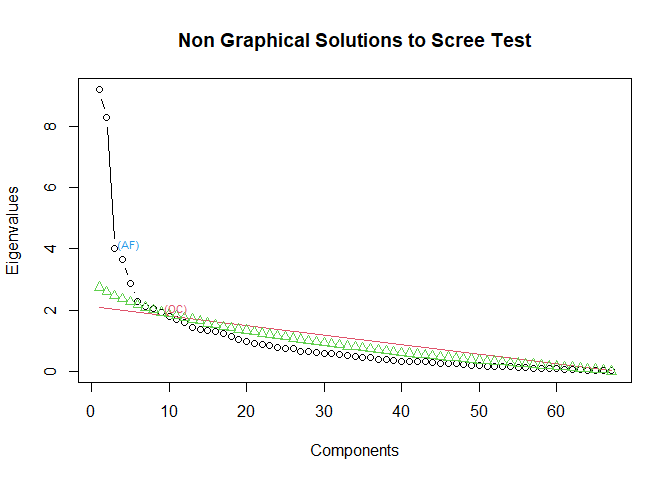
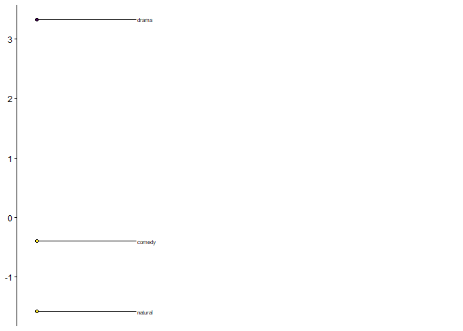
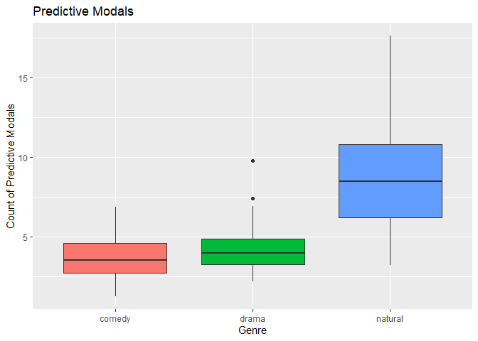
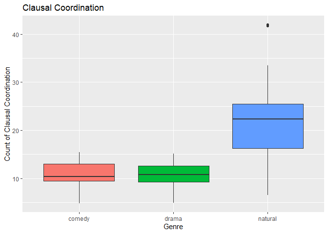
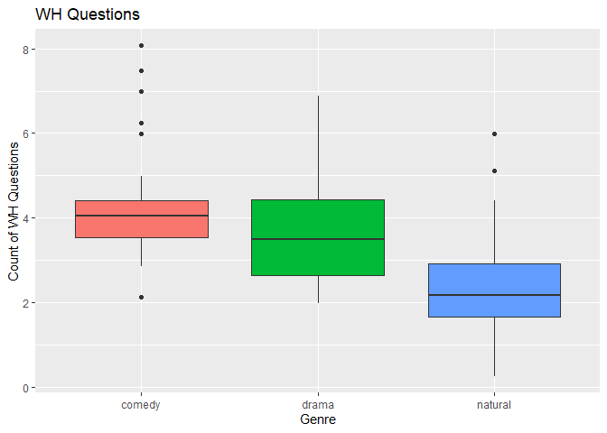
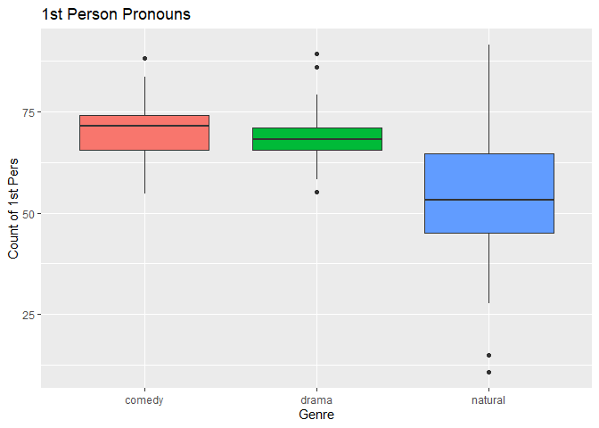
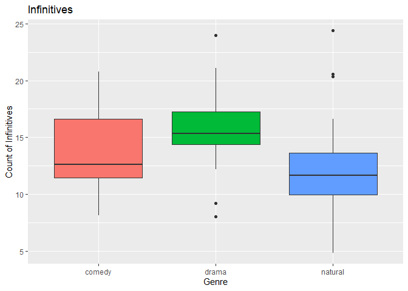
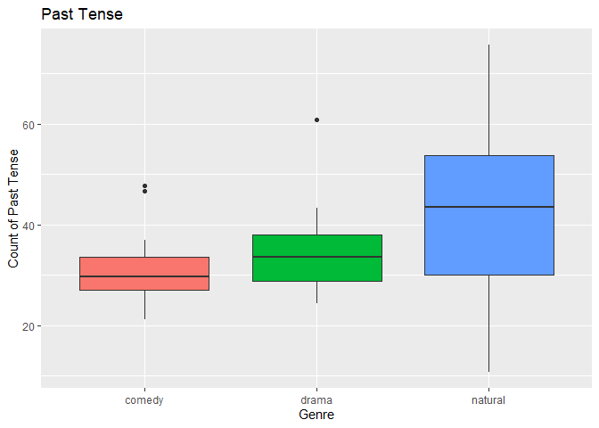
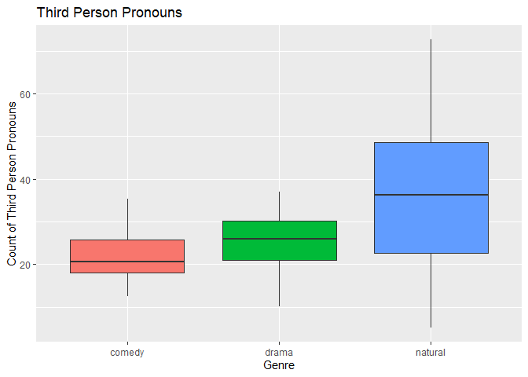

# Dramaticity Pipeline
Zach Shultz
2026-11-06

## EXISTING piepline

This pipeline was used for progress report 2, it has been updated to
reflect the final analysis

## Prereqs

In addition to tidyverse packages, `corrplot`, `mda.biber`, `spacyr`,
`udpipe`, and `quanteda` will all need to be installed.

Additionally, an installation of python (3.10+) is required to utilize
spaCy R. Once these are installed, everything can be completed within R
as described below.

[Information on spaCy](https://spacy.io/usage)

``` r
library(tidyverse)
```

    ── Attaching core tidyverse packages ──────────────────────── tidyverse 2.0.0 ──
    ✔ dplyr     1.2.1     ✔ readr     2.2.0
    ✔ forcats   1.0.1     ✔ stringr   1.6.0
    ✔ ggplot2   4.0.3     ✔ tibble    3.3.1
    ✔ lubridate 1.9.5     ✔ tidyr     1.3.2
    ✔ purrr     1.2.2     
    ── Conflicts ────────────────────────────────────────── tidyverse_conflicts() ──
    ✖ dplyr::filter() masks stats::filter()
    ✖ dplyr::lag()    masks stats::lag()
    ℹ Use the conflicted package (<http://conflicted.r-lib.org/>) to force all conflicts to become errors

``` r
library(corrplot)
```

    corrplot 0.95 loaded

``` r
library(lme4)
```

    Loading required package: Matrix

    Attaching package: 'Matrix'

    The following objects are masked from 'package:tidyr':

        expand, pack, unpack

``` r
library(mda.biber)
library(spacyr)
```

    Warning: package 'spacyr' was built under R version 4.6.2

``` r
library(quanteda)
```

    Warning: package 'quanteda' was built under R version 4.6.2

    Package version: 4.5.1
    Unicode version: 15.1
    ICU version: 74.1
    Parallel computing: 8 of 8 threads used.
    See https://quanteda.io for tutorials and examples.

``` r
library(udpipe)
```

    Warning: package 'udpipe' was built under R version 4.6.2

``` r
library(pseudobibeR)
```

    Warning: package 'pseudobibeR' was built under R version 4.6.2

## Intro

This pipeline describes the process of completing the MDA. See the
[Santa Barbara Pipeline](santa_barbara_pipeline.md) and the [Scraps from
the Loft Pipeline](scraps_from_loft_pipeline.md) for information on how
the component data frames were assembled and where the data came from.

This document is used to describe how the individual data frames were
combined, the shape of the resulting data frame, and the steps of the
analysis. Finally, it will briefly go over the results. If more details
are needed to explain the steps of the MDA, see the [MDA
document](mda.md). Final results and exploration of the analysis is
documented in the [Dramaticity Analysis](final_report.md) document.

## Creating all_transcripts DF

First, we load in the `tv_show_transcripts` pipeline as a csv.

``` r
tv_show_df <- read.csv("private/tv_show_transcripts.csv")

tv_show_df
```

Then, we can load in the SB data frame.

``` r
sb_files <- read.csv("private/sb_files.csv")

sb_files
```

Finally, we combine the two data frames.

``` r
all_transcripts <- rbind(sb_files, tv_show_df)

all_transcripts <- all_transcripts|>
  #renaming the first column to id and the second column to text as that is what is expected for the pseudobiber pipeline below
  rename(text = "clean_words",
         doc_id = "id")
```

Now we save this file to our private folder!

``` r
write_csv(all_transcripts, "private/all_transcripts.csv")
```

## Summary `all_transcripts`

Below is some summary information about what is included in
all_transcripts:

Number of rows and columns in our df and breakdown of genre

``` r
nrow(all_transcripts)
```

    [1] 120

``` r
ncol(all_transcripts)
```

    [1] 2

``` r
all_transcripts |>
  mutate(doc_id = case_when(str_detect(doc_id, "trn") ~ "natural", 
                        str_detect(doc_id, "comedy") ~ "comedy", 
                        str_detect(doc_id, "drama") ~ "drama")) |>
  mutate(nwords = (str_count(text, "\\w+"))) |>
  count(doc_id)
```

       doc_id  n
    1  comedy 28
    2   drama 32
    3 natural 60

Approximate number of words in our df:

``` r
all_transcripts |>
  mutate(nwords = (str_count(text, "\\w+"))) |>
  summarize(sum(nwords))
```

      sum(nwords)
    1      538942

Approximate number of words by category:

``` r
all_transcripts |>
  mutate(doc_id = case_when(str_detect(doc_id, "trn") ~ "natural", 
                        str_detect(doc_id, "comedy") ~ "comedy", 
                        str_detect(doc_id, "drama") ~ "drama")) |>
  mutate(nwords = (str_count(text, "\\w+"))) |>
  group_by(doc_id) |>
  summarize(sum(nwords))
```

    # A tibble: 3 × 2
      doc_id  `sum(nwords)`
      <chr>           <int>
    1 comedy         116947
    2 drama          158660
    3 natural        263335

## Tagging all_transcripts and Getting Factor Loadings

In order to parse the data, it is necessary to use spaCy to tag all of
the words in the document. Then, an R package called `pseudobibeR` can
be used to get the 67 linguistic features created by Biber. For more
details on the process, see
[here](https://github.com/browndw/pseudobibeR). Note that this package
and the following were created by David Brown, a linguist at CMU!

First, we can ensure that all texts are normalized and in a corpus
format. A glimpse of the corpus format can be seen below.

``` r
# 1. Read the texts and normalize typographic quotes (’ -> ')
all_transcripts$clean_words <- utf8::utf8_normalize(all_transcripts$clean_words, map_quote = TRUE)
corp <- corpus(all_transcripts)

corp
```

Next, we will download an English parsing model through `udpipe`. This
is essentially a wrapper that allows R users to run tagging and parsing.

``` r
# 2. Parse with udpipe (the model is downloaded once)
model <- udpipe_download_model(language = "english")
```

    Downloading udpipe model from https://raw.githubusercontent.com/jwijffels/udpipe.models.ud.2.5/master/inst/udpipe-ud-2.5-191206/english-ewt-ud-2.5-191206.udpipe to C:/Users/justz/Dramaticity-Multidimensional-Analysis/english-ewt-ud-2.5-191206.udpipe

     - This model has been trained on version 2.5 of data from https://universaldependencies.org

     - The model is distributed under the CC-BY-SA-NC license: https://creativecommons.org/licenses/by-nc-sa/4.0

     - Visit https://github.com/jwijffels/udpipe.models.ud.2.5 for model license details.

     - For a list of all models and their licenses (most models you can download with this package have either a CC-BY-SA or a CC-BY-SA-NC license) read the documentation at ?udpipe_download_model. For building your own models: visit the documentation by typing vignette('udpipe-train', package = 'udpipe')

    Downloading finished, model stored at 'C:/Users/justz/Dramaticity-Multidimensional-Analysis/english-ewt-ud-2.5-191206.udpipe'

Once the above code has been run once, only the below code will be
necessary to load in the model as below.

``` r
ud_model <- udpipe_load_model(model$file_model)
```

And parse each character in the corpus. This process takes some time,
around ten minutes.

``` r
parsed <- udpipe_annotate(ud_model, x = as.character(corp), doc_id = docnames(corp), trace = 100)
```

    2026-11-27 12:28:59.648631 Annotating text fragment 1/120
    2026-11-27 12:39:45.869164 Annotating text fragment 101/120

``` r
parsed_df <- read_csv("private/parsed.csv")
```

    Rows: 673797 Columns: 14
    ── Column specification ────────────────────────────────────────────────────────
    Delimiter: ","
    chr (9): doc_id, sentence, token, lemma, upos, xpos, feats, dep_rel, misc
    dbl (4): paragraph_id, sentence_id, token_id, head_token_id
    lgl (1): deps

    ℹ Use `spec()` to retrieve the full column specification for this data.
    ℹ Specify the column types or set `show_col_types = FALSE` to quiet this message.

Finally, we can get the feature weights which will be used in the second
half of functions. This function also takes some time to run, about 2-3
minutes.

``` r
# 3. Count the features: one row per document
#since we've already created and saved this document, we can simply load it in as below
#features <- biber(parsed)
```

``` r
features <- read_csv("private/features.csv")
```

    Rows: 120 Columns: 68
    ── Column specification ────────────────────────────────────────────────────────
    Delimiter: ","
    chr  (1): doc_id
    dbl (67): f_01_past_tense, f_02_perfect_aspect, f_03_present_tense, f_04_pla...

    ℹ Use `spec()` to retrieve the full column specification for this data.
    ℹ Specify the column types or set `show_col_types = FALSE` to quiet this message.

## Getting Dimension Scores

As can be seen in the `features` data structure, we have feature counts
for each text. These can now be run through another series of functions
to get the overall feature scores for the 67 linguistic features for
each text and dimension scores.

Once read in, the process described
[here](https://cran.r-project.org/web/packages/mda.biber/vignettes/introduction.html)
is used to run our first attempt at the MDA. This is the second half of
David Brown’s pipeline!

Note that the documents are being renamed below such that each
individual file is represented by it’s category and no other
information. For instance, each comedy TV show will only be known as
comedy. This is necessary since we are comparing the groups as a whole.

``` r
#ok so first we are assigning our data set to the variable d
d <- features |>
  #then, we are modifying a column called doc_id to rename columns that contain either "comedy", "drama" or "trn" with "comedy", "drama", and "natural". 
  mutate(doc_id = case_when(str_detect(doc_id, "comedy") ~ "comedy",
                            str_detect(doc_id, "drama") ~ "drama",
                            str_detect(doc_id, "trn") ~ "natural")) |>
  #then we are modifying our new column so the strings are factors
  mutate(doc_id = as.factor(doc_id)) |>
  #removes the columns with values = 0
  select(where(~ any(. != 0)))
```

This changes the labels of the id column so that our groups are formed,
turns them into factors, and removes any columns with 0 instances. Any
features not observed should not be there to run a proper mda as below.

## Determining Ideal Number of Factors

The next step in the analysis is to decide on how many factors should be
formed from the factor loadings. See the [MDA](mda.md) document for more
details on this important decision.

``` r
screeplot_mda(d)
```



A screeplot displays ‘eigenvalues’. Simply put, it groups feature
weights based on their impact on the data. Large feature loadings will
therefore be grouped together, medium feature loadings grouped together,
and so on.

The ‘elbow’ is a term used to describe the cut off point where the
features being grouped are not particularly impactful in terms of their
predictive power. Visually, it is where the line becomes less steep.
Anything at or below the elbow is considered ‘scree’.

In this case, we have decided to use the AF (accelerated factor) value
to determine the elbow. This is a mathematical measure of where the line
first begins to curve. Since there are two points above that, we should
include two factors. Note that there is no easy way to determine the
elbow or how many dimensions to include. If it is found that more
dimensions might better suit an understanding of the data, re-analysis
should be done.

In order to be sure that an MDA is worth running, we want to see that
there is high correlation and inverse correlation among textual
features. While this step is expected for textual features, it is still
nice to run to be sure.

``` r
cor_m <- cor(d[,-1], method = "pearson")

corrplot(cor_m, type = "upper", order = "hclust", tl.col = "black", tl.srt = 45, diag = F, tl.cex = 0.5)
```


As we can see, there are multiple areas of dark blue (high correlation)
and dark red (high inverse correlation). Therefore, we know that a
multidimensional analysis makes sense for these groups.

## Running the MDA

Next we are running the MDA. Essentially, we are getting mean scores for
the significant feature loadings within each dimension (\>.35).

``` r
#now for the actual mda, factors is set equal to 2 because of the screeplot results
m <- mda_loadings(d, n_factors = 2)
```

And below we can see these mean values:

``` r
dimension_scores <- attributes(m)$group_means

dimension_scores
```

        group    Factor1    Factor2
    1  comedy -0.4063865  -9.641276
    2   drama  3.3317098 -10.431191
    3 natural -1.5872649  10.062564

Immediately, we can see a substantial difference between Factor 1 and
Factor 2. While Drama scores quite distinctly from the other two groups
in Factor 1, Natural language is quite different along Factor 2. A
deeper analysis of the differences between these two factors will likely
lead to a better understanding of where dramaticity comes into play.
These differences can be even better visualized in graphic form.

Below are the highest correlation features by factor.

``` r
#values arranged in descending order for factor 1
attributes(m)$loadings |> arrange(-Factor1)
```

                                      Factor1      Factor2
    f_44_mean_word_length         0.917618683 -0.360802002
    f_39_prepositions             0.791399304  0.176947204
    f_16_other_nouns              0.748254730 -0.400875028
    f_14_nominalizations          0.668069450  0.026803782
    f_17_agentless_passives       0.652140966  0.158139788
    f_40_adj_attr                 0.535292769  0.036751431
    f_15_gerunds                  0.456882193  0.253837040
    f_18_by_passives              0.456834204 -0.002041751
    f_27_past_participle_whiz     0.428333154 -0.057529408
    f_28_present_participle_whiz  0.421854336 -0.178714748
    f_30_that_obj                 0.406312093  0.182779904
    f_57_verb_suasive             0.392510387 -0.126766285
    f_43_type_token               0.373395321 -0.838171465
    f_31_wh_subj                  0.367766821 -0.045063332
    f_64_phrasal_coordination     0.353303743  0.055260912
    f_24_infinitives              0.327228387 -0.412768308
    f_45_conjuncts                0.322435739  0.234700410
    f_33_pied_piping              0.305824834  0.020338677
    f_58_verb_seem                0.296388502 -0.054801585
    f_48_amplifiers               0.295017432  0.114399157
    f_51_demonstratives           0.288850149  0.253337597
    f_02_perfect_aspect           0.283695567  0.074398452
    f_34_sentence_relatives       0.283148561  0.217833253
    f_29_that_subj                0.273647844  0.291568829
    f_46_downtoners               0.192475692 -0.170725465
    f_25_present_participle       0.154381675  0.271978489
    f_35_because                  0.154312612  0.318664952
    f_21_that_verb_comp           0.144451039 -0.011941679
    f_36_though                   0.127147886  0.037291234
    f_26_past_participle          0.112072595  0.140841952
    f_04_place_adverbials         0.111449825  0.118718972
    f_22_that_adj_comp            0.097361555 -0.038181857
    f_32_wh_obj                   0.064389971 -0.029730654
    f_55_verb_public              0.057120722  0.342155527
    f_66_neg_synthetic            0.019475331 -0.479669445
    f_05_time_adverbials          0.017507458 -0.185546942
    f_20_existential_there        0.009851697  0.337927838
    f_13_wh_question             -0.004481128 -0.563142311
    f_08_third_person_pronouns   -0.005091207  0.500619007
    f_01_past_tense              -0.021035373  0.403098489
    f_61_stranded_preposition    -0.028852035  0.498928687
    f_37_if                      -0.047710458  0.147853883
    f_11_indefinite_pronouns     -0.049247142 -0.428642155
    f_38_other_adv_sub           -0.128933866  0.385413333
    f_65_clausal_coordination    -0.132609072  0.777277681
    f_52_modal_possibility       -0.166501222 -0.332124811
    f_54_modal_predictive        -0.168822569  0.694750479
    f_53_modal_necessity         -0.169149744 -0.311903312
    f_62_split_infinitive        -0.199071203  0.085987104
    f_60_that_deletion           -0.225973758 -0.063755179
    f_47_hedges                  -0.226526286  0.128512201
    f_41_adj_pred                -0.248509296 -0.023267464
    f_63_split_auxiliary         -0.262795443  0.011070538
    f_50_discourse_particles     -0.341846003  0.370582994
    f_07_second_person_pronouns  -0.353892475 -0.680125719
    f_23_wh_clause               -0.362788105 -0.239553756
    f_06_first_person_pronouns   -0.376132258 -0.410485975
    f_59_contractions            -0.380857719  0.974338873
    f_19_be_main_verb            -0.395226274  0.292347414
    f_67_neg_analytic            -0.428958862  0.874282781
    f_10_demonstrative_pronoun   -0.433313176  0.394149240
    f_56_verb_private            -0.451254882  0.245920545
    f_12_proverb_do              -0.467222976  0.069600491
    f_03_present_tense           -0.481098596 -0.182900850
    f_49_emphatics               -0.526833942  0.108207461
    f_09_pronoun_it              -0.540570268  0.388947622
    f_42_adverbs                 -0.607777476  0.297992314

``` r
#values arranged in descending order for factor 1
#note that m contains the raw values while specifying loadings gets us the values normalized around 0
attributes(m)$loadings |> arrange(-Factor2)
```

                                      Factor1      Factor2
    f_59_contractions            -0.380857719  0.974338873
    f_67_neg_analytic            -0.428958862  0.874282781
    f_65_clausal_coordination    -0.132609072  0.777277681
    f_54_modal_predictive        -0.168822569  0.694750479
    f_08_third_person_pronouns   -0.005091207  0.500619007
    f_61_stranded_preposition    -0.028852035  0.498928687
    f_01_past_tense              -0.021035373  0.403098489
    f_10_demonstrative_pronoun   -0.433313176  0.394149240
    f_09_pronoun_it              -0.540570268  0.388947622
    f_38_other_adv_sub           -0.128933866  0.385413333
    f_50_discourse_particles     -0.341846003  0.370582994
    f_55_verb_public              0.057120722  0.342155527
    f_20_existential_there        0.009851697  0.337927838
    f_35_because                  0.154312612  0.318664952
    f_42_adverbs                 -0.607777476  0.297992314
    f_19_be_main_verb            -0.395226274  0.292347414
    f_29_that_subj                0.273647844  0.291568829
    f_25_present_participle       0.154381675  0.271978489
    f_15_gerunds                  0.456882193  0.253837040
    f_51_demonstratives           0.288850149  0.253337597
    f_56_verb_private            -0.451254882  0.245920545
    f_45_conjuncts                0.322435739  0.234700410
    f_34_sentence_relatives       0.283148561  0.217833253
    f_30_that_obj                 0.406312093  0.182779904
    f_39_prepositions             0.791399304  0.176947204
    f_17_agentless_passives       0.652140966  0.158139788
    f_37_if                      -0.047710458  0.147853883
    f_26_past_participle          0.112072595  0.140841952
    f_47_hedges                  -0.226526286  0.128512201
    f_04_place_adverbials         0.111449825  0.118718972
    f_48_amplifiers               0.295017432  0.114399157
    f_49_emphatics               -0.526833942  0.108207461
    f_62_split_infinitive        -0.199071203  0.085987104
    f_02_perfect_aspect           0.283695567  0.074398452
    f_12_proverb_do              -0.467222976  0.069600491
    f_64_phrasal_coordination     0.353303743  0.055260912
    f_36_though                   0.127147886  0.037291234
    f_40_adj_attr                 0.535292769  0.036751431
    f_14_nominalizations          0.668069450  0.026803782
    f_33_pied_piping              0.305824834  0.020338677
    f_63_split_auxiliary         -0.262795443  0.011070538
    f_18_by_passives              0.456834204 -0.002041751
    f_21_that_verb_comp           0.144451039 -0.011941679
    f_41_adj_pred                -0.248509296 -0.023267464
    f_32_wh_obj                   0.064389971 -0.029730654
    f_22_that_adj_comp            0.097361555 -0.038181857
    f_31_wh_subj                  0.367766821 -0.045063332
    f_58_verb_seem                0.296388502 -0.054801585
    f_27_past_participle_whiz     0.428333154 -0.057529408
    f_60_that_deletion           -0.225973758 -0.063755179
    f_57_verb_suasive             0.392510387 -0.126766285
    f_46_downtoners               0.192475692 -0.170725465
    f_28_present_participle_whiz  0.421854336 -0.178714748
    f_03_present_tense           -0.481098596 -0.182900850
    f_05_time_adverbials          0.017507458 -0.185546942
    f_23_wh_clause               -0.362788105 -0.239553756
    f_53_modal_necessity         -0.169149744 -0.311903312
    f_52_modal_possibility       -0.166501222 -0.332124811
    f_44_mean_word_length         0.917618683 -0.360802002
    f_16_other_nouns              0.748254730 -0.400875028
    f_06_first_person_pronouns   -0.376132258 -0.410485975
    f_24_infinitives              0.327228387 -0.412768308
    f_11_indefinite_pronouns     -0.049247142 -0.428642155
    f_66_neg_synthetic            0.019475331 -0.479669445
    f_13_wh_question             -0.004481128 -0.563142311
    f_07_second_person_pronouns  -0.353892475 -0.680125719
    f_43_type_token               0.373395321 -0.838171465

If we consider Drama TV shows to generally have language that is more
exaggerated compared to comedy TV shows and real life, then we could
posit that dimension 1 is more likely to reflect the dimension of
dramaticity. It is likely that dimension 2, then, more reflects
differences between natural discourse and TV show discourse that are
shared between the drama and comedy genre. A further analysis of the
specific features involved will likely support this.

Given this hypothesis, for now we will focus on dimension 1.

``` r
#mapping the mean dimension scores centered around 0
stickplot_mda(m, n_factor = 1)
```



This graph is a useful tool for understanding what the dimension
analysis does. Based on the mean scores we saw earlier, the graph places
all groups around 0. Since scores are averaged around 0, it is very easy
to see how the different groups are on opposite ends of the spectrum for
this dimension.

``` r
heatmap_mda(m, n_factor = 1)
```

    Registered S3 method overwritten by 'car':
      method           from
      na.action.merMod lme4


By including the relevant features, things become even clearer. One
important reminder is that highly positive and highly negative features
(such as mean word length and adverbs) are in a trade off relationship.
Among these groups, as the mean length of a word increases we would
expect fewer adverbs to be present and vice versa.

Two immediate thoughts based on this graph:

- it is suprising that emphatics are less likely to occur in drama TV
  show transcripts

- it is surprising that adverbs are also so unlikely in drama TV show
  transcripts

It will be important to sample some of the tags for these documents to
better understand what is causing these rates. What sorts of words are
being tagged as adverbs so frequently in the SB files?

## Linear Mixed Effect Model

A good next step in the analysis is to determine whether these groupings
are significantly different along their dimensions. In other words, how
well do the dimensions and their features predict a given group.

## Defining Dimensions

In order to actually define our dimension, let’s create two dfs. Each
will depict the relevant linguistic features (positive and negative) in
order of their significance or how strongly they seem to occur within
the dimension.

``` r
loadings <- attributes(m)$loadings

#creating a new document of just the loadings
loadings
```

                                      Factor1      Factor2
    f_01_past_tense              -0.021035373  0.403098489
    f_02_perfect_aspect           0.283695567  0.074398452
    f_03_present_tense           -0.481098596 -0.182900850
    f_04_place_adverbials         0.111449825  0.118718972
    f_05_time_adverbials          0.017507458 -0.185546942
    f_06_first_person_pronouns   -0.376132258 -0.410485975
    f_07_second_person_pronouns  -0.353892475 -0.680125719
    f_08_third_person_pronouns   -0.005091207  0.500619007
    f_09_pronoun_it              -0.540570268  0.388947622
    f_10_demonstrative_pronoun   -0.433313176  0.394149240
    f_11_indefinite_pronouns     -0.049247142 -0.428642155
    f_12_proverb_do              -0.467222976  0.069600491
    f_13_wh_question             -0.004481128 -0.563142311
    f_14_nominalizations          0.668069450  0.026803782
    f_15_gerunds                  0.456882193  0.253837040
    f_16_other_nouns              0.748254730 -0.400875028
    f_17_agentless_passives       0.652140966  0.158139788
    f_18_by_passives              0.456834204 -0.002041751
    f_19_be_main_verb            -0.395226274  0.292347414
    f_20_existential_there        0.009851697  0.337927838
    f_21_that_verb_comp           0.144451039 -0.011941679
    f_22_that_adj_comp            0.097361555 -0.038181857
    f_23_wh_clause               -0.362788105 -0.239553756
    f_24_infinitives              0.327228387 -0.412768308
    f_25_present_participle       0.154381675  0.271978489
    f_26_past_participle          0.112072595  0.140841952
    f_27_past_participle_whiz     0.428333154 -0.057529408
    f_28_present_participle_whiz  0.421854336 -0.178714748
    f_29_that_subj                0.273647844  0.291568829
    f_30_that_obj                 0.406312093  0.182779904
    f_31_wh_subj                  0.367766821 -0.045063332
    f_32_wh_obj                   0.064389971 -0.029730654
    f_33_pied_piping              0.305824834  0.020338677
    f_34_sentence_relatives       0.283148561  0.217833253
    f_35_because                  0.154312612  0.318664952
    f_36_though                   0.127147886  0.037291234
    f_37_if                      -0.047710458  0.147853883
    f_38_other_adv_sub           -0.128933866  0.385413333
    f_39_prepositions             0.791399304  0.176947204
    f_40_adj_attr                 0.535292769  0.036751431
    f_41_adj_pred                -0.248509296 -0.023267464
    f_42_adverbs                 -0.607777476  0.297992314
    f_43_type_token               0.373395321 -0.838171465
    f_44_mean_word_length         0.917618683 -0.360802002
    f_45_conjuncts                0.322435739  0.234700410
    f_46_downtoners               0.192475692 -0.170725465
    f_47_hedges                  -0.226526286  0.128512201
    f_48_amplifiers               0.295017432  0.114399157
    f_49_emphatics               -0.526833942  0.108207461
    f_50_discourse_particles     -0.341846003  0.370582994
    f_51_demonstratives           0.288850149  0.253337597
    f_52_modal_possibility       -0.166501222 -0.332124811
    f_53_modal_necessity         -0.169149744 -0.311903312
    f_54_modal_predictive        -0.168822569  0.694750479
    f_55_verb_public              0.057120722  0.342155527
    f_56_verb_private            -0.451254882  0.245920545
    f_57_verb_suasive             0.392510387 -0.126766285
    f_58_verb_seem                0.296388502 -0.054801585
    f_59_contractions            -0.380857719  0.974338873
    f_60_that_deletion           -0.225973758 -0.063755179
    f_61_stranded_preposition    -0.028852035  0.498928687
    f_62_split_infinitive        -0.199071203  0.085987104
    f_63_split_auxiliary         -0.262795443  0.011070538
    f_64_phrasal_coordination     0.353303743  0.055260912
    f_65_clausal_coordination    -0.132609072  0.777277681
    f_66_neg_synthetic            0.019475331 -0.479669445
    f_67_neg_analytic            -0.428958862  0.874282781

``` r
#we have set our threshold at .35 or -.35 as is standard
threshold <- 0.35

# Dimension 1, taking only the factor 1 loadings above the absolute threshold
dim1_positive <- loadings[loadings$Factor1 >= threshold, ]
dim1_negative <- loadings[loadings$Factor1 <= -threshold, ]

# Dimension 2, taking only the factor 1 loadings above the absolute threshold
dim2_positive <- loadings[loadings$Factor2 >= threshold, ]
dim2_negative <- loadings[loadings$Factor2 <= -threshold, ]

#creating dimension 1 positive by itself with the factors in descending order
dim1_positive <- dim1_positive |>
  select(Factor1) |>
  arrange(desc(Factor1))

#creating dimension 1 negative by itself with the factors in ascending order
dim1_negative <- dim1_negative |>
  select(Factor1) |>
  arrange(Factor1)

#combine the vectors
dim1 <- dim1_positive |>
  rbind(dim1_negative)


#creating dimension 2 positive by itself with the factors in ascending order
dim2_positive <- dim2_positive |>
  select(Factor2) |>
  arrange(desc(Factor2))

#creating dimension 2 negative by itself with the factors in ascending order
dim2_negative <- dim2_negative |>
  select(Factor2) |>
  arrange(Factor2)

#combine the vectors
dim2 <- dim2_positive |>
  rbind(dim2_negative)

#results
dim1
```

                                    Factor1
    f_44_mean_word_length         0.9176187
    f_39_prepositions             0.7913993
    f_16_other_nouns              0.7482547
    f_14_nominalizations          0.6680695
    f_17_agentless_passives       0.6521410
    f_40_adj_attr                 0.5352928
    f_15_gerunds                  0.4568822
    f_18_by_passives              0.4568342
    f_27_past_participle_whiz     0.4283332
    f_28_present_participle_whiz  0.4218543
    f_30_that_obj                 0.4063121
    f_57_verb_suasive             0.3925104
    f_43_type_token               0.3733953
    f_31_wh_subj                  0.3677668
    f_64_phrasal_coordination     0.3533037
    f_42_adverbs                 -0.6077775
    f_09_pronoun_it              -0.5405703
    f_49_emphatics               -0.5268339
    f_03_present_tense           -0.4810986
    f_12_proverb_do              -0.4672230
    f_56_verb_private            -0.4512549
    f_10_demonstrative_pronoun   -0.4333132
    f_67_neg_analytic            -0.4289589
    f_19_be_main_verb            -0.3952263
    f_59_contractions            -0.3808577
    f_06_first_person_pronouns   -0.3761323
    f_23_wh_clause               -0.3627881
    f_07_second_person_pronouns  -0.3538925

``` r
dim2
```

                                   Factor2
    f_59_contractions            0.9743389
    f_67_neg_analytic            0.8742828
    f_65_clausal_coordination    0.7772777
    f_54_modal_predictive        0.6947505
    f_08_third_person_pronouns   0.5006190
    f_61_stranded_preposition    0.4989287
    f_01_past_tense              0.4030985
    f_10_demonstrative_pronoun   0.3941492
    f_09_pronoun_it              0.3889476
    f_38_other_adv_sub           0.3854133
    f_50_discourse_particles     0.3705830
    f_43_type_token             -0.8381715
    f_07_second_person_pronouns -0.6801257
    f_13_wh_question            -0.5631423
    f_66_neg_synthetic          -0.4796694
    f_11_indefinite_pronouns    -0.4286422
    f_24_infinitives            -0.4127683
    f_06_first_person_pronouns  -0.4104860
    f_16_other_nouns            -0.4008750
    f_44_mean_word_length       -0.3608020

### Dimension 1 - Should this incorporate other literature? Probably

Dimension 1 is slightly larger and is composed of 15 positive features
and 13 negative ones. It is possible that this dimension is a bit
overloaded (in the sense that it is trying to descirbe multiple
underlying dimensions at the same time) which makes it more challenging
to interpret. It groups Comedy and Natural discourse closer together on
one end and Drama on the other.

Many of the positive features essentially boil down to higher
information density. This fits in with Kozloff’s idea that one key ways
TV show dialogue differs from natural discourse is “communication of the
narrative” (p. 33). Mean word length, prepositions, higher nouns overall
(other nouns), nominalizations, agentless passives, and gerunds, which
make up the five largest weights, all suggest that their texts are more
focused on information and specificity (Biber 105-106). TTR and phrasal
coordination, while less significant, also suggest this idea of more
densely packed information with a need to express ideas faster. TTR
could also be suggesting that natural discourse is more repetitive (or
involved) which it likely is (`source`). This makes sense for the drama
category as a genre distinction since often drama have more convoluted
plots and need to communicate the narrative to viewers through dialogue
(Kozloff).

Elaborated explanation specific to verbal explanations: For verbal
communication, several features have been considered methods for quickly
expanding on information in a verbal context. Passed participle WHIZ and
present participle whiz allow for elaboration on nouns more fluidly in
conversation (Biber 105) and *that* in object position is similarly a
way to elaborate on topics in conversation. The high use of these again
suggests that drama particularly uses dialogue as a way to transfer
information.

Attributive adjectives

The above features could be considered a more practical, intuitive
aspect of TV shows. Since they are constrained to a limited time frame
and meant to be entertaining, they are often more information dense
(`source`). While this could certainly contribute to the dialogue
“sounding” more dramatic, some other features more suggest this notion.
While less significant on this dimension (possible because comedy is
closer on them).

agentless passives, by passives, and verb suasives

As for the negative features, we have many that pattern
straightforwardly as “high information.” These include

In conclusion, dimension 1 generally measures the different information
loads that are being carried depending on the type of discourse being
depicted. When looking at the average natural conversation (which varies
greatly) we see a lower information density. Much of the space of
language in conversation is taken up by repetitions, indexicalities, and
stance taking. These features are usually not meant to convey meaning to
an interlocutor that is not present (ie an audience). Drama, on the
other hand, needs to move the plot forward. Comedy generally falls
somewhere in between, but depending on the particular feature it can
lean quite far away from natural discourse. Real natural discourse also
shows clausal features that show more impromptu methods of elaboration.
This suggests that this dimension also takes into acount methods of
elaboration.

So, dimension 1 can be described as: **high information and planned
elaboration - low information and high indexicality/impromptu
elaboration**

It makes sense, then, that comedy is grouped somewhat closer to drama.
Comedy has been shown in Quaglio and Al-Surmi and other works to be
close to natural discourse in a number of ways. And the plot of comedy
generally requires less exposition through dialogue. And as a final
reminder, this dimension is not as effective at dividing even drama from
natural discourse. In part, that is because some (even many) forms of
natural discourse will require high information and more planned
elaboration. This dimension is less reliable.

### Dimension 2

Dramaticity

This dimension has much more promise to showcase those features that
represent dramaticity. It is a smaller dimension made up of only 11
positive features and 9 negative ones. Natural discourse is grouped on
the positive side while Comedy and Drama are grouped on the negative
side. Already, this seems to suggest a dimension that is better dividing
TV show discourse from Natural discourse.

Some of the positive features are repeated from dimension 1, suggesting
that these are particularly potent features for creating an cline
displaying natural-comedy-drama. These include contractions, negative
analytics, demonstrative pronoun, and pronoun it. All of these suggest
that for the dramas sampled, there is a specific and clear nature to the
language compared with natural discourse. Contractions and negative
synthetic elements are both easier to use with processing constraints
such as in a real conversation (`source`). TV shows are pre-written and
rehearsed, so these processing constraints are not an issue. And as
mentioned at length in the first dimension, they want the audience to
follow the dialogue easily. Demonstrative pronouns and pronoun it have
lower weights but generally suggest the same differences above. Both are
ways of quickly referring to things throughout the conversation,
representing high interactivity. However for TV shows, high use of these
functions can come off as repetitive or even dull (`source`).

One overarching difference Quaglio focused on was that language is
informal. For his comparison, he found the Friends was even *more*
informal than natural discourse. However, a more complex finding here
seems to be appearing. Features like discourse particles and stranded
prepositions both co-occur positively with the positive side of
dimension 2. These features are all marking some amount of informality.
It is worth noting that many of the features in the previous paragraph
could be grouped here. So, degree of informality seems to be one
interpretation of the features so far. It is worth investigating why
Quaglio’s findings differed. One likely explanation is that due to a
wider range of settings, there are simply too many TV shows in both
comedy and drama that have reason to be more formal. Indeed, Friends
could even be an outlier relative to the comedy genre in terms of
informality.

Third person pronouns and past tense could be associated with narrative
language. Quaglio has an entire chapter devoted to differences in how
narratives are portrayed in natural discourse versus television.
Ultimately, both mediums make use of narratives, but natural discourse
seems to use it more often. In this way, the findings of this dimension
comparison seem to mirror findings by Quaglio. Story-telling is not
prominent in either, but TV shows engage in it even less. Why is this?

And lastly, for the positive features, we have clausal coordination,
predictive modals, adverbial subordinators. These are all discourse
features that show that natural discourse features more elaborations. In
a TV show, lots of elaboration is somewhat reserved for special moments
like monologues. For example, clausal coordinators, a very highly
weighted feature, exemplifies how often people combine clauses using
conjunctions in natural discourse. An easy way to clarify what you are
saying, expand, and carry on conversation is to coordinate a new
conjunction (`source`). Adverbial subordinators and predictive modals
are very similar in this sense.

For negative features, TTR and synthetic negatives contrast the first
paragraph discussing positive features. They suggest that the texts
within Drama and Comedy are less spontaneous or elaborated, which makes
sense.

Higher rates of both second and first persons pronouns and indefinite
pronouns deserve some attention. This suggests a distinct difference in
the manner of conversations happening in comedy and drama versus natural
discourses. Basically, while natural discourses feature a bit more story
telling and discussing of other people or discussion of the past, drama
and comedy TV shows feature *a lot* more discussion of individuals
within the conversation or discussion of people more generally. This
could be because TV show characters are often “egotistical”, they focus
on themselves and those immediately around them. Indefinite pronouns
specifically could also be a result of the common importance of tension
coming from the unknown. For example in procedurals we often see
conversations like “somebody died” or “anybody could have done it”.

WH questions deserves it’s own explanation. This feature has actually
been found to be more frequent in TV show discourse before, and has been
studied by Bednarek. Basically, it is well accounted that wh-questions
are more common in TV show discourse. Why is this? This is one of those
very cool linguistic characteristics that actually suggests dramaticity!
In a TV show, questions create intrigue, explain the plot, raise the
stakes, and create exciting dialogue. NOTE – Bednarek finds the most
common trigrams for wh questions, this would be so cool to see for our
corpus!!

Infinites are also somewhat difficult to place on their own. Similar to
suasive verbs in dimension 1, they have been linked to persuasive
elements in text. However, if it were about persuassion, we would expect
to see more examples of other elements that suggest persuassion mixed in
such as verb suasives and various types of modals. In fact, we see the
opposite. Predictive modals are positive in dimension 2, meaning
infinitives are in complementary distribution with them. Why then are
infinitives found in dimension 2? From a more micro-analysis of the
texts, it seems that infinitives occur more in drama (and to some extent
comedy) because they are a means of expressing a character’s internal
desires or feelings. Expressions such as “want to” are particularly
prevalant.

Other nouns and mean word length have the smallest weight on the
negative side for dimension 2. So, while we are still seeing some
evidence of longer words and more nouns, it is not as evident as in
dimension 1. Still, it is quite clear that comedy and drama both have
slightly longer words on average and more nouns. As has been stated,
this is likely a result of the higher information density of TV shows.

In conclusion, Dimension 2 is closely related to Dimension 1 and there
is certainly some cross-over. However, rather than a focus on
information extent and methods of elaboration, it focuses more on the
form the content takes and the sorts of structures required, namely more
formality (contractions, stranded prepositions), character focus
(wh-questions), and infrequent narrations. While narrative features are
not common in any discourse (compared to, say, a novel), there is a
clear division in which natural discourses engage in fairly frequent
narratives but TV show dialogues restrict them to monologues and special
moments (`source`).

We could then describe this dimension as **informal/vague and relatively
narrative to formal/clear and character driven**

## Deep Dive into Features

So, which features can be said to represent dramaticity? In a sense, all
of them. While a distinction can be made (or indeed many distinctions)
between the manner in which these features make a text *seem* more
dramatic (what their function is within TV shows), those distinctions
are debated in the literature and often depend on the particular show. A
TV show that consists of friends talking over the dinner able versus one
with doctors performing operations will obviously differ. However, the
beauty of a multidimensional analysis which looks at various genres is
that we can see broad patterns that still sneak through for any given TV
show or natural discourse.

Our two dimensions are currently:

**Dimension 1: high information and planned elaboration - low
information and high indexicality/impromptu elaboration**

**Dimension 2: informal/vague and relatively narrative to formal/clear
and character driven**

But another, less specific way of putting them would be:

**Dimension 1: Plot/Content heavy - Plot/Content light**

**Dimension 2: TV Show - Natural Discourse**

While this interpretation is not perfect, it lines up well with other
literature. Quaglio examines 3 characteristics for which comedy is
distant from Natural discourse: “Vague language, Emotional language,
Informal Language, and Narrative language” (`source`). While Quaglio is
only looking at one comedy and no TV shows from the drama genre,
informality, vagueness, and narrativity were all present in Dimension 2
to some extent. Some of these did not match Quaglio’s findings (notably
formality), but that could be for a variety of reasons. From Kozloff’s
perspective, at least 3 features, “anchorage of the diegesis and
characters,” “character revelation,” and “opportunities for ‘star
turns,’” are present to some extent in Dimension 2 as well (`source`).
Additionally, wh-questions, explored by Bednarek, emerge as a prevelant
feature. All of this suggests that Dimension 2 is stronger and matches
findings from previous literature.

It is time to dive into some specific examples to provide evidence for
these dimensions and to explore which particular features may best
showcase dramaticity. Based on a review of previous literature, the
factor weights, and with a general preference for dimension 2, three
categories have been created to explain how this dimension predicts a
texts position.

Interactivity and evidentiality:

- predictive modals

- clausal coordination

Character focus:

- Wh-questions

- first person pronouns

- infinitives

Narrativity:

- third person pronouns

- past tense = narrative

To do this, we will need a data frame created from `parsed` from which
we can find particular patterns, get examples, and create common
pairings. Luckily, we have actually already done this! There is a very
simple expression we can use to create a data frame from a udpipe which
was accomplished above.

``` r
parsed_df
```

    # A tibble: 673,797 × 14
       doc_id  paragraph_id sentence_id sentence    token_id token lemma upos  xpos 
       <chr>          <dbl>       <dbl> <chr>          <dbl> <chr> <chr> <chr> <chr>
     1 trn_001            1           1 So you don…        1 So    so    ADV   RB   
     2 trn_001            1           1 So you don…        2 you   you   PRON  PRP  
     3 trn_001            1           1 So you don…        3 do    do    AUX   VBP  
     4 trn_001            1           1 So you don…        4 n't   not   PART  RB   
     5 trn_001            1           1 So you don…        5 need  need  VERB  VB   
     6 trn_001            1           1 So you don…        6 to    to    PART  TO   
     7 trn_001            1           1 So you don…        7 go    go    VERB  VB   
     8 trn_001            1           1 So you don…        8 borr… borr… NOUN  NN   
     9 trn_001            1           1 So you don…        9 equi… equi… NOUN  NN   
    10 trn_001            1           1 So you don…       10 from  from  ADP   IN   
    # ℹ 673,787 more rows
    # ℹ 5 more variables: feats <chr>, head_token_id <dbl>, dep_rel <chr>,
    #   deps <lgl>, misc <chr>

Note that this is simply the spaCy tagging for every document. This is
not the Biber tagging. In order to get Biber counts, we will have to
find how the features were counted (often using a dict associated with
Biber) and then search through `parsed_df`.

We will also need to reproduce word counts in order to normalize
features to see meaningful total that line up with graphing `features`.

Rough word count:

``` r
word_counts <- parsed_df |>
  mutate(group = case_when(str_detect(doc_id, "trn") ~ "natural",
                            str_detect(doc_id, "comedy") ~ "comedy",
                            str_detect(doc_id, "drama") ~ "drama")) |>
  group_by(group) |>
  summarise(total_words = n(), .groups = "drop")

word_counts
```

    # A tibble: 3 × 2
      group   total_words
      <chr>         <int>
    1 comedy       147922
    2 drama        198271
    3 natural      327604

### Interactivity

#### Predictive Modals

To start, let’s visualize what the counts say about the distribution of
predictive modals in the data.

``` r
modal_pred <- features |> 
  #select doc_id and the relevant feature
  select(doc_id, f_54_modal_predictive) 

modal_pred
```

    # A tibble: 120 × 2
       doc_id  f_54_modal_predictive
       <chr>                   <dbl>
     1 trn_001                  8.22
     2 trn_002                  6.01
     3 trn_003                  7.63
     4 trn_004                 10.8 
     5 trn_005                  3.99
     6 trn_006                  5.27
     7 trn_007                  8.45
     8 trn_008                 11.1 
     9 trn_009                  6.34
    10 trn_010                  8.48
    # ℹ 110 more rows

``` r
modal_pred_graph <- modal_pred |>
  #marge our 3 groups
  mutate(doc_id = case_when(str_detect(doc_id, "trn") ~ "natural",
                            str_detect(doc_id, "comedy") ~ "comedy",
                            str_detect(doc_id, "drama") ~ "drama")) 

ggplot(modal_pred_graph, aes(x = doc_id, y = f_54_modal_predictive, fill = doc_id)) +
  geom_boxplot() +
  labs(x = "Genre", y = "Count of Predictive Modals", title = "Predictive Modals") +
  theme(legend.position = "none")
```



Predictive Modals were one of the most highly weighted positive features
within Dimension 2. From the graph above, we can see why. While natural
discourse still has quite a spread, there is not very much overlap
between groups. So, atural discourse uses predictive modals at a very
high rate compared with either other genre. Why is this the case?

We can use our dictionary list to get a list of the lemmas and tags used
to find and measure predictive modals.

\$f_54_modal_predictive \[1\] “will_md” “would_md” “shall_md” “’d_md”
“’ll_md” “wo_md” “sha_md”

We can also search parsed_df to find what tag md refers to.

``` r
parsed_df
```

    # A tibble: 673,797 × 14
       doc_id  paragraph_id sentence_id sentence    token_id token lemma upos  xpos 
       <chr>          <dbl>       <dbl> <chr>          <dbl> <chr> <chr> <chr> <chr>
     1 trn_001            1           1 So you don…        1 So    so    ADV   RB   
     2 trn_001            1           1 So you don…        2 you   you   PRON  PRP  
     3 trn_001            1           1 So you don…        3 do    do    AUX   VBP  
     4 trn_001            1           1 So you don…        4 n't   not   PART  RB   
     5 trn_001            1           1 So you don…        5 need  need  VERB  VB   
     6 trn_001            1           1 So you don…        6 to    to    PART  TO   
     7 trn_001            1           1 So you don…        7 go    go    VERB  VB   
     8 trn_001            1           1 So you don…        8 borr… borr… NOUN  NN   
     9 trn_001            1           1 So you don…        9 equi… equi… NOUN  NN   
    10 trn_001            1           1 So you don…       10 from  from  ADP   IN   
    # ℹ 673,787 more rows
    # ℹ 5 more variables: feats <chr>, head_token_id <dbl>, dep_rel <chr>,
    #   deps <lgl>, misc <chr>

``` r
#first off, what is md?
unique(parsed_df$xpos)
```

     [1] "RB"    "PRP"   "VBP"   "VB"    "TO"    "NN"    "IN"    ","     "DT"   
    [10] "NNS"   "."     "UH"    "VBG"   "NNP"   "WRB"   "JJ"    "VBZ"   "RBR"  
    [19] "JJS"   "CC"    "WDT"   "MD"    "PDT"   "PRP$"  "VBD"   "VBN"   "HYPH" 
    [28] "CD"    "EX"    ":"     "WP"    "RP"    "POS"   "JJR"   "RBS"   "SYM"  
    [37] "GW"    "ADD"   "''"    "NFP"   "FW"    "AFX"   "NNPS"  "WP$"   "``"   
    [46] "$"     "LS"    "XX"    "-LRB-" "-RRB-"

Then, using parsed_df, we can search for the most common predictive
modals for each text.

``` r
pred_modal <- parsed_df |>
  #create categories again 
  mutate(group = case_when(str_detect(doc_id, "comedy") ~ "comedy",
                           str_detect(doc_id, "drama") ~ "drama",
                           str_detect(doc_id, "trn") ~ "natural")) |>
  #filter for modals tag
  filter(str_detect(xpos, "^(MD)"), 
         #filter for any of the accepted lemmas in the lemma column
         str_detect(lemma, "(will|would|shall|'d|'ll|wo|sha)")) |>
  #group by the category
  group_by(group) |>
  #count the lemma and name the column frequency
  count(lemma, name = "frequency") |>
  #put them in order of frequency and only take the most common 10
  slice_max(order_by = frequency, n = 10) 

pred_modal
```

    # A tibble: 17 × 3
    # Groups:   group [3]
       group   lemma  frequency
       <chr>   <chr>      <int>
     1 comedy  would        276
     2 comedy  will         169
     3 comedy  shall          3
     4 comedy  two            3
     5 comedy  twill          1
     6 comedy  wo             1
     7 comedy  wwould         1
     8 drama   would        339
     9 drama   will         333
    10 drama   shall         10
    11 drama   two            2
    12 drama   twill          1
    13 natural would       1271
    14 natural will        1040
    15 natural shall         17
    16 natural 'll            9
    17 natural wwould         1

Looking at the actual numbers, we see that ‘would’ and ‘will’ are the
most important modals for determining these counts by far. To find out
why this is the case, let’s take a closer look at an example from each
of our groups.

``` r
modal_examps <- parsed_df |>
  #create our groups
  mutate(group = case_when(str_detect(doc_id, "comedy") ~ "comedy",
                           str_detect(doc_id, "drama") ~ "drama",
                           str_detect(doc_id, "trn") ~ "natural")) |>
  #detect modals 
  filter(str_detect(xpos, "MD"),
         #detect predictive modals
         str_detect(lemma, "(will|would|shall|'d|'ll|wo|sha)")) |>
  #selects the main columns we want
  select(c(doc_id, sentence_id, sentence, token, lemma, upos, feats))


#normalized count
modal_count <- parsed_df |>
  mutate(group = case_when(str_detect(doc_id, "comedy") ~ "comedy",
                           str_detect(doc_id, "drama") ~ "drama",
                           str_detect(doc_id, "trn") ~ "natural")) |>
  filter(str_detect(xpos, "MD"),
         str_detect(lemma, "(will|would|shall|'d|'ll|wo|sha)")) |>
  group_by(group) |>
    summarise(modal_count = n(), .groups = "drop")
  
modal_count <- modal_count |>
  left_join(word_counts, by = "group") |>
  mutate(normalized = (modal_count / total_words) * 1000)

modal_count
```

    # A tibble: 3 × 4
      group   modal_count total_words normalized
      <chr>         <int>       <int>      <dbl>
    1 comedy          454      147922       3.07
    2 drama           685      198271       3.45
    3 natural        2338      327604       7.14

``` r
modals_pitt_42_sheldon <- modal_examps |>
  #filter out only the 3 examples we want
  filter(doc_id == "the_pitt_drama" | doc_id == "trn_042" | doc_id == "young_sheldon_comedy") 

#raw count by word
modals_pitt_42_sheldon |>
  group_by(doc_id) |>
  count(lemma)
```

    # A tibble: 7 × 3
    # Groups:   doc_id [3]
      doc_id               lemma     n
      <chr>                <chr> <int>
    1 the_pitt_drama       will     13
    2 the_pitt_drama       would    22
    3 trn_042              shall     1
    4 trn_042              will     11
    5 trn_042              would    19
    6 young_sheldon_comedy will      8
    7 young_sheldon_comedy would     4

We can immediately see that our comedy example features far fewer
’will’s and ’would’s. The natural example and the drama example are
actually quite close in their rates, in fact this time the drama is
slightly higher overall. Why is this the case?

In the natural discourse, we see a lot of assertions through predictive
modals.

TRN

KENDRA: Her mom **would** know. I’ll have Melanie call you.

KITTY: Oh,

KENDRA: Her mom call you,

KITTY: right, right, her mom **wouldn’t** lie

For example, in trn 42, we see a family argument. On 514, Kendra, the
daughter, argues that her friend’s mom would support her version of the
story. This is in an attempt to convince her mom that she is telling the
truth. In this way, it is often used as an argumentative style and one
that is apparently extremely common in natural discourse. One reason
might be that it is a softening of arguments we do not see as frequently
in TV.

The Pitt SPEAKER 1: But you have to understand that **will** be the last
test that we **would** do.

SPEAKER 2: If it comes back that there’s no blood flow to Nick’s brain,
it **would** confirm beyond a shadow of a doubt that there’s been brain
death, which **would** mean that he’s gone.

SPEAKER 1: Then we wait and see.

In the example from the Pitt, we see a similar example of discourse
centered around assertions. In the example, the speakers are doctors
trying to decide how to proceed with a patient. Since The Pitt is a
medical procedure for which each season covers a single day, it makes
sense that it would have frequent examples of individuals making
assertions.

Young Sheldon did not have any of these densely clustered predictive
modals.

So, overall, we can say that as speakers try to express their points of
view on events that occurred, they frequently use predictive modals as a
tactic for convincing other interlocutors of their perspective. Why is
this more frequent in natural discourse? I believe it is possible that
since TV shows are generally less interactive than natural discourse,
they make less use of features that are heavily utilized in interactive
settings. When people talk in real life, it often centers on these kinds
of arguments, soft back and forths in which people try to convince each
other of things. In TV shows, while this strategy is certainly
showcased, it is sparser than in natural discourse (in most cases).

#### clausal coordination

Again, we will start with a visualization of clausal coordination.

``` r
clausal_coord <- features |> 
  select(doc_id, f_65_clausal_coordination) 

clausal_coord
```

    # A tibble: 120 × 2
       doc_id  f_65_clausal_coordination
       <chr>                       <dbl>
     1 trn_001                      30.5
     2 trn_002                      19.4
     3 trn_003                      15.5
     4 trn_004                      25.4
     5 trn_005                      23.3
     6 trn_006                      33.5
     7 trn_007                      33.2
     8 trn_008                      26.4
     9 trn_009                      13.0
    10 trn_010                      28.3
    # ℹ 110 more rows

``` r
clausal_coord_graph <- clausal_coord |>
  mutate(doc_id = case_when(str_detect(doc_id, "trn") ~ "natural",
                            str_detect(doc_id, "comedy") ~ "comedy",
                            str_detect(doc_id, "drama") ~ "drama")) |>
  arrange(doc_id)

ggplot(clausal_coord_graph, aes(x = doc_id, y = f_65_clausal_coordination, fill = doc_id)) +
  geom_boxplot() +
  labs(x = "Genre", y = "Count of Clausal Coordination", title = "Clausal Coordination") +
  theme(legend.position = "none")
```



Here we see a distribution very similar to predictive modals. We can use
similar tactics above to find only coordinating clauses. Though this
time, it was a bit more complicated. In the [R documentation of the
github for
mda.biber](https://github.com/browndw/pseudobibeR/blob/main/R/parse_functions.R),
we find the following code which was implemented for finding coordinated
clauses.

    df[["f_65_clausal_coordination"]] <- tokens %>%
        dplyr::group_by(.data$doc_id) %>%
        dplyr::filter(
          .data$tag == "CC",
          .data$dep_rel != "ROOT",
          (
            dplyr::lead(.data$dep_rel == "nsubj") |
              dplyr::lead(.data$dep_rel == "nsubj", 2) |
              dplyr::lead(.data$dep_rel == "nsubj", 3)
          )
        ) %>%
        dplyr::tally() %>%
        dplyr::rename(f_65_clausal_coordination = "n")

Using this code, we can create a data frame made up of the coordinated
conjunctions.

``` r
clausal_coord <- parsed_df |>
  #get everything in the order the sentences should go in
  arrange(doc_id, sentence_id, token_id) |>
  #group by the categories
  group_by(doc_id) |>
  #find coordinating cunjunction tags
  filter(xpos == "CC",
         #exclude dependency relations not equal to root
         dep_rel != "root",
         (
           #lead basically finds following values so we can compare to make sure they're still subjects
           lead(dep_rel == "nsubj") |
           lead(dep_rel == "nsubj", 2) |
           lead(dep_rel == "nsubj", 3)
         )) |>
  mutate(group = case_when(str_detect(doc_id, "trn") ~ "natural",
                            str_detect(doc_id, "comedy") ~ "comedy",
                            str_detect(doc_id, "drama") ~ "drama")) 

#normalized counts
claus_count <- parsed_df |>
  arrange(doc_id, sentence_id, token_id) |>
  group_by(doc_id) |>
  filter(xpos == "CC",
         dep_rel != "root",
         (
           lead(dep_rel == "nsubj") |
           lead(dep_rel == "nsubj", 2) |
           lead(dep_rel == "nsubj", 3)
         )) |>
  mutate(group = case_when(str_detect(doc_id, "trn") ~ "natural",
                            str_detect(doc_id, "comedy") ~ "comedy",
                            str_detect(doc_id, "drama") ~ "drama")) |>
  group_by(group) |>
  summarise(claus_count = n(), .groups = "drop")

claus_count <- claus_count |>
  left_join(word_counts, by = "group") |>
  mutate(normalized = (claus_count / total_words) * 1000)

claus_count
```

    # A tibble: 3 × 4
      group   claus_count total_words normalized
      <chr>         <int>       <int>      <dbl>
    1 comedy         1260      147922       8.52
    2 drama          1736      198271       8.76
    3 natural        5934      327604      18.1 

``` r
#similar to above, we find 3 specific examples
clausal_white_sunny_31 <- clausal_coord |>
  filter(doc_id == "trn_031" | doc_id == "the_white_lotus_drama" | doc_id == "its_always_sunny_in_philadelphia_comedy")

#raw count
clausal_coord |>
  group_by(group) |>
  count()
```

    # A tibble: 3 × 2
    # Groups:   group [3]
      group       n
      <chr>   <int>
    1 comedy   1260
    2 drama    1736
    3 natural  5934

Based on these numbers, natural discourse clearly uses clausal
coordination to a greater extent on average. Let’s look at some specific
examples and consider why.

``` r
clausal_white_sunny_31 |>
  group_by(doc_id) |>
  count(lemma)
```

    # A tibble: 11 × 3
    # Groups:   doc_id [3]
       doc_id                                  lemma      n
       <chr>                                   <chr>  <int>
     1 its_always_sunny_in_philadelphia_comedy and       31
     2 its_always_sunny_in_philadelphia_comedy but        9
     3 its_always_sunny_in_philadelphia_comedy or         1
     4 the_white_lotus_drama                   and       45
     5 the_white_lotus_drama                   but       14
     6 the_white_lotus_drama                   or         5
     7 trn_031                                 &          1
     8 trn_031                                 and       68
     9 trn_031                                 but       42
    10 trn_031                                 either     1
    11 trn_031                                 or         7

Looks like these shows follow the overall trend very closely with comedy
having the fewest clausal coordinators.

Natural: SHERRY: She just has these little things that come every once
in a while **and** they’re always serious.

BETH: Why does she think she had a kidney infection.

ROSEMARY: Well she’s got .. a pain, at .. at her waist, in the back, on
one side only, **and** she’s not, going to the bathroom as often as she
should, even though she’s drinking gallons of water,

We can immediately see that natural discourse frequently uses clausal
coordinators simply to expand on thoughts and more thoroughly describe a
situation. It is very easy to use coordinators to elaborate on points
fluidly in conversation.

We can see a similar pattern in the excerpts below. The coordinators are
essentially being used for the same purpose. However, the distribution
of these coordinators is very different. For TV shows, these pop up
commonly in monologues, or at least lengthy segments of speech. In those
cases, they serve their purpose: to highlight that the main speaker is
elaborating on a subject. They might even serve especially well at this
since we are conditioned to expect more information from these
coordinators. For natural discourse, these kinds of elaborations pop up
all over.

Its Always Sunny in Philadelphia: SPEAKER 1: My whole life, I thought I
had shit for brains, mainly because my mom would stick a Tootsie Roll in
my ear when I slept. **And** I would wake up and find it **and** I would
think there was actually shit in my brains. Leaking out of your head at
night? I think it’s because she loved me so much **and** she wanted to
keep me at home, you know?

\[Charlie\] Sure, yeah.

SPEAKER 1: And then I wised up **and** I caught on to her love ruse,
**and** I realized that I probably did have some kind of disorder.”

The White Lotus: SPEAKER 1: The room is– is beautiful, **and** we have
this ocean view, **and** we face west, so we get these incredible
sunsets.

SPEAKER 2: Yeah.

SPEAKER 1: You’d love Hawaii. Everything’s so lush. Where we are, it
isn’t so overdeveloped. **And** there’s all of this amazing food and
pastries.”

#### Summary

Both clausal coordinators and predictive modals are examples of how TV
shows utilize a sampling method to make dialogue *feel* interactive
without feeling too repetitive. They can also use these features in
particular situations to evoke specific emotions, a key feature of TV
discourse (Kozloff). These features are quite similar in distribution
between the drama and comedy genres.

### Character Focus

#### WH Questions

``` r
wh <- features |> 
  select(doc_id, f_13_wh_question) 

wh
```

    # A tibble: 120 × 2
       doc_id  f_13_wh_question
       <chr>              <dbl>
     1 trn_001            0.934
     2 trn_002            2.91 
     3 trn_003            3.01 
     4 trn_004            1.90 
     5 trn_005            5.98 
     6 trn_006            2.55 
     7 trn_007            1.88 
     8 trn_008            2.18 
     9 trn_009            2.61 
    10 trn_010            0.257
    # ℹ 110 more rows

``` r
wh_graph <- wh |>
  mutate(doc_id = case_when(str_detect(doc_id, "trn") ~ "natural",
                            str_detect(doc_id, "comedy") ~ "comedy",
                            str_detect(doc_id, "drama") ~ "drama")) |>
  arrange(doc_id)

ggplot(wh_graph, aes(x = doc_id, y = f_13_wh_question, fill = doc_id)) +
  geom_boxplot() +
  labs(x = "Genre", y = "Count of WH Questions", title = "WH Questions") +
  theme(legend.position = "none")
```



WH Questions are most common in the comedy genre followed by drama, and
finally natural discourse. The frequency of WH Questions in TV shows has
actually been examined at length and this finding is yet another example
of this trend. Let’s explore why this occurs through specific examples
in the corpus.

``` r
#raw counts
wh_questions <- parsed_df |>
  group_by(doc_id) |>
  filter(str_detect(xpos, "^W") == T,
       upos != "DET" & lead(dep_rel == "aux"),
      (lag(upos == "PUNCT", default = T) |
          lag(upos == "PUNCT", 2, default = T))) |>
  mutate(group = case_when(str_detect(doc_id, "trn") ~ "natural",
                            str_detect(doc_id, "comedy") ~ "comedy",
                            str_detect(doc_id, "drama") ~ "drama")) 


wh_count <- parsed_df |>
  group_by(doc_id) |>
  filter(str_detect(xpos, "^W") == T,
       upos != "DET" & lead(dep_rel == "aux"),
      (lag(upos == "PUNCT", default = T) |
          lag(upos == "PUNCT", 2, default = T))) |>
  mutate(group = case_when(str_detect(doc_id, "trn") ~ "natural",
                            str_detect(doc_id, "comedy") ~ "comedy",
                            str_detect(doc_id, "drama") ~ "drama")) |>
  group_by(group) |>
  summarise(wh_count = n(), .groups = "drop")

wh_count <- wh_count |>
  left_join(word_counts, by = "group") |>
  mutate(normalized = (wh_count / total_words) * 1000)

wh_count
```

    # A tibble: 3 × 4
      group   wh_count total_words normalized
      <chr>      <int>       <int>      <dbl>
    1 comedy       481      147922       3.25
    2 drama        587      198271       2.96
    3 natural      590      327604       1.80

``` r
#similar to above, we find 3 specific examples
wh_trn_057 <- wh_questions |>
  filter(doc_id == "trn_057" | doc_id == "beauty_in_black_drama" | doc_id == "curb_your_enthusiasm_comedy")

wh_questions |>
  group_by(group) |>
  count()
```

    # A tibble: 3 × 2
    # Groups:   group [3]
      group       n
      <chr>   <int>
    1 comedy    481
    2 drama     587
    3 natural   590

In this case, our raw counts differ from the normalized trend. By
looking at the numbers normalized per thousand, we see the trend from
the graph above. Let’s take a look at our specific examples.

``` r
wh_trn_057 |>
  filter(doc_id == "trn_057" | doc_id == "beauty_in_black_drama" | doc_id == "curb_your_enthusiasm_comedy") |>
  group_by(doc_id) |>
  count(lemma)
```

    # A tibble: 9 × 3
    # Groups:   doc_id [3]
      doc_id                      lemma     n
      <chr>                       <chr> <int>
    1 beauty_in_black_drama       how       6
    2 beauty_in_black_drama       what     18
    3 beauty_in_black_drama       why       8
    4 curb_your_enthusiasm_comedy how       3
    5 curb_your_enthusiasm_comedy what     31
    6 curb_your_enthusiasm_comedy who       1
    7 curb_your_enthusiasm_comedy why       5
    8 trn_057                     what      3
    9 trn_057                     who       1

``` r
wh_trn_057
```

    # A tibble: 76 × 15
    # Groups:   doc_id [3]
       doc_id     paragraph_id sentence_id sentence token_id token lemma upos  xpos 
       <chr>             <dbl>       <dbl> <chr>       <dbl> <chr> <chr> <chr> <chr>
     1 trn_057               1         273 Hoo, th…       13 what  what  PRON  WP   
     2 trn_057               1         277 What ar…        1 What  what  PRON  WP   
     3 trn_057               1         311 But I l…       17 who   who   PRON  WP   
     4 trn_057               1         442 So you'…       18 what  what  PRON  WP   
     5 beauty_in…            1          11 What do…        1 What  what  PRON  WP   
     6 beauty_in…            1          45 Why are…        1 Why   why   ADV   WRB  
     7 beauty_in…            1         147 What ar…        1 What  what  PRON  WP   
     8 beauty_in…            1         214 why did…        1 why   why   ADV   WRB  
     9 beauty_in…            1         218 What’s …        1 What  what  PRON  WP   
    10 beauty_in…            1         275 Why are…        1 Why   why   ADV   WRB  
    # ℹ 66 more rows
    # ℹ 6 more variables: feats <chr>, head_token_id <dbl>, dep_rel <chr>,
    #   deps <lgl>, misc <chr>, group <chr>

These results are quite shocking! Admittedly, these are TV shows with
*particularly* high counts, but the trend holds true for many of the TV
shows. Why is this the case?

In the natural discourse below, Nick is a judo instructor. He is trying
to teach his students a new throw. His question at the end is
rhetorical, and likely meant to encourage the student to try the throw.
In natural discourse, these kinds of rhetorical questions are not as
common as simple fact seeking questions (`source`).

Natural: NICK: Now I’m gonna be a sucker, and watch your feet. This- Now
you’re just walking in on me man, you have- you have no outer winding
pull here. Jerk me to you. Hoo, there we go, I’m on my tiptoes, what are
you waiting for.

In the discourse below, Horace and Kimmie are having an argument about
the status of their relationship. Almost immediately after Kimmie storms
off, Angel asks her what she was doing in Horace’s room. This is a prime
example of how TV can use wh-questions for “expression of
emotion/opinion” (Kimmie’s line shows that she is confused and upset by
Horace’s aloofness) and to progress the narrative in an exciting way
(Angel’s immediate interest in what Kimmie was doing) (Bednarek, 2014a).

Beauty in Black: KIMMIE: Look… \[scoffs\] **What**… what the hell am I
missing here?

HORACE: Kimmie.

ANGEL: **What** were you doing in there?

KIMMIE: Mind your business.

Based on the overall counts, this also seems to be slightly more common
in comedies than either other group. This matches Quaglio’s finding that
Friends featured a lot of language used to express emotions, which
wh-questions are certainly very capable of doing (`Quaglio`).

#### First Person Pronouns

``` r
first_pron <- features |> 
  select(doc_id, f_06_first_person_pronouns) 

first_pron
```

    # A tibble: 120 × 2
       doc_id  f_06_first_person_pronouns
       <chr>                        <dbl>
     1 trn_001                       48.0
     2 trn_002                       56.0
     3 trn_003                       48.4
     4 trn_004                       57.3
     5 trn_005                       75.4
     6 trn_006                       48.0
     7 trn_007                       64.8
     8 trn_008                       48.2
     9 trn_009                       47.0
    10 trn_010                       91.4
    # ℹ 110 more rows

``` r
first_pron_graph <- first_pron |>
  mutate(doc_id = case_when(str_detect(doc_id, "trn") ~ "natural",
                            str_detect(doc_id, "comedy") ~ "comedy",
                            str_detect(doc_id, "drama") ~ "drama")) |>
  arrange(doc_id)

ggplot(first_pron_graph, aes(x = doc_id, y = f_06_first_person_pronouns, fill = doc_id)) +
  geom_boxplot() +
  labs(x = "Genre", y = "Count of 1st Pers", title = "1st Person Pronouns") +
  theme(legend.position = "none")
```



``` r
parsed_df
```

    # A tibble: 673,797 × 14
       doc_id  paragraph_id sentence_id sentence    token_id token lemma upos  xpos 
       <chr>          <dbl>       <dbl> <chr>          <dbl> <chr> <chr> <chr> <chr>
     1 trn_001            1           1 So you don…        1 So    so    ADV   RB   
     2 trn_001            1           1 So you don…        2 you   you   PRON  PRP  
     3 trn_001            1           1 So you don…        3 do    do    AUX   VBP  
     4 trn_001            1           1 So you don…        4 n't   not   PART  RB   
     5 trn_001            1           1 So you don…        5 need  need  VERB  VB   
     6 trn_001            1           1 So you don…        6 to    to    PART  TO   
     7 trn_001            1           1 So you don…        7 go    go    VERB  VB   
     8 trn_001            1           1 So you don…        8 borr… borr… NOUN  NN   
     9 trn_001            1           1 So you don…        9 equi… equi… NOUN  NN   
    10 trn_001            1           1 So you don…       10 from  from  ADP   IN   
    # ℹ 673,787 more rows
    # ℹ 5 more variables: feats <chr>, head_token_id <dbl>, dep_rel <chr>,
    #   deps <lgl>, misc <chr>

First person pronouns are quite a bit more common in comedy and drama
than in natural discourse.

\$f_06_first_person_pronouns \[1\] “i_prp*” ”me_prp*” “us_prp*”
”my_prp*” “we_prp*”\
\[6\] ”our_prp*” “myself_prp*” ”ourselves_prp*”

``` r
first_pers <- parsed_df |>
  #create our groups
  mutate(group = case_when(str_detect(doc_id, "comedy") ~ "comedy",
                           str_detect(doc_id, "drama") ~ "drama",
                           str_detect(doc_id, "trn") ~ "natural")) |>
  #detect pronouns 
  filter(str_detect(xpos, "PRP"),
         #detect pronouns
         str_detect(lemma, "\\b(I|i|Me|me|Us|us|My|my|We|we|Our|our|Myself|myself|Ourselves|ourselves)\\b")) |>
  #selects the main columns we want
  select(c(doc_id, sentence_id, sentence, token, lemma, upos, feats))

first_pers
```

    # A tibble: 33,964 × 7
       doc_id  sentence_id sentence                          token lemma upos  feats
       <chr>         <dbl> <chr>                             <chr> <chr> <chr> <chr>
     1 trn_001           3 Well, we're gonna have to find s… we    we    PRON  Case…
     2 trn_001           4 So, I'm gonna                     I     I     PRON  Case…
     3 trn_001           5 We're not gonna do the feet toda… We    we    PRON  Case…
     4 trn_001           5 We're not gonna do the feet toda… I     I     PRON  Case…
     5 trn_001           6 I mean you get so tired.          I     I     PRON  Case…
     6 trn_001           7 n- you just, it takes well, it t… me    I     PRON  Case…
     7 trn_001           7 n- you just, it takes well, it t… I     I     PRON  Case…
     8 trn_001           7 n- you just, it takes well, it t… I     I     PRON  Case…
     9 trn_001           9 I mean, Oh I mean I trim horses,… I     I     PRON  Case…
    10 trn_001           9 I mean, Oh I mean I trim horses,… I     I     PRON  Case…
    # ℹ 33,954 more rows

``` r
#normalized count
first_count <- parsed_df |>
  mutate(group = case_when(str_detect(doc_id, "comedy") ~ "comedy",
                           str_detect(doc_id, "drama") ~ "drama",
                           str_detect(doc_id, "trn") ~ "natural")) |>
  filter(str_detect(xpos, "prp"),
         str_detect(lemma, "\\b(I|i|Me|me|Us|us|My|my|We|we|Our|our|Myself|myself|Ourselves|ourselves)\\b")) |>
  group_by(group) |>
    summarise(first_count = n(), .groups = "drop")
  
first_count <- first_count |>
  left_join(word_counts, by = "group") |>
  mutate(normalized = (first_count / total_words) * 1000)

first_count
```

    # A tibble: 0 × 4
    # ℹ 4 variables: group <chr>, first_count <int>, total_words <int>,
    #   normalized <dbl>

``` r
first_019_last_adults <- first_pers |>
  #filter out only the 3 examples we want
  filter(doc_id == "the_last_of_us_drama" | doc_id == "trn_019" | doc_id == "adults_comedy") 

#raw count by word
first_019_last_adults |>
  group_by(doc_id) |>
  count(lemma)
```

    # A tibble: 16 × 3
    # Groups:   doc_id [3]
       doc_id               lemma         n
       <chr>                <chr>     <int>
     1 adults_comedy        I           193
     2 adults_comedy        i             1
     3 adults_comedy        my           21
     4 adults_comedy        myself        2
     5 adults_comedy        us            2
     6 adults_comedy        we           24
     7 the_last_of_us_drama I           181
     8 the_last_of_us_drama my           18
     9 the_last_of_us_drama myself        1
    10 the_last_of_us_drama ourselves     2
    11 the_last_of_us_drama us            2
    12 the_last_of_us_drama we           55
    13 trn_019              I           179
    14 trn_019              i             2
    15 trn_019              my           20
    16 trn_019              we           31

``` r
first_019_last_adults
```

    # A tibble: 734 × 7
       doc_id  sentence_id sentence                          token lemma upos  feats
       <chr>         <dbl> <chr>                             <chr> <chr> <chr> <chr>
     1 trn_019           1 Well, with all- Not before I gra… I     I     PRON  Case…
     2 trn_019           3 or two weeks from now, or whenev… I     I     PRON  Case…
     3 trn_019           4 Mom? do I really have to go thro… I     I     PRON  Case…
     4 trn_019           4 Mom? do I really have to go thro… I     I     PRON  Case…
     5 trn_019           4 Mom? do I really have to go thro… my    my    PRON  Numb…
     6 trn_019           7 Okay, because out of the eight t… I     I     PRON  Case…
     7 trn_019           7 Okay, because out of the eight t… I     I     PRON  Case…
     8 trn_019           7 Okay, because out of the eight t… I     I     PRON  Case…
     9 trn_019           8 They weren't really important, b… I     I     PRON  Case…
    10 trn_019           9 and so now I'm paranoid that I'm… I     I     PRON  Case…
    # ℹ 724 more rows

Ok, we can see from these results that the most common pronoun is ‘I’ by
far. Next, ‘we’ for all of the groups with ‘my’ being a sometimes close
second. All other pronouns look surprisingly rare. Starting with drama
and comedy, an explanation for the greater number of first person
pronouns can be found when considering the main topic of TV shows: the
characters. TV shows are largely about the characters they depict
(`source?`). First person pronouns are a primary way for characters to
make observations, statements, and emotional expressions within the
dialogue. ‘We’ is so prominent in this episode of The Last of Us, for
instance, because it is largely about a couple discussing their lives
and their relationship during an apocalypse.

This scene depicts the characters trying to grapple with what their
lives are going to be like. Bill asks a rhetorical question in 883 as he
believes there is no reason for them to have dinner parties. Frank
replies, redefining his expectation of their life as having friends in
887 and expands on his views in 891. Finally Bill counters again, saying
their lives cannot be that way in 892 and 894. Ultimately, the pronoun
‘we’ has come to represent their life in a natural, engaging way for the
audience.

The Last of Us BILL: Are-are **we** hosting formal garden parties now?

FRANK: No.

FRANK: But **we** are gonna have friends.

BILL: Excuse me?

FRANK: **We**’re gonna make friends, and **we** will invite them to
visit.

BILL: **We** don’t have friends, Frank.

BILL: **We** will never have friends because there are no friends to be
had.

Adults: ANTON: No, you let him pee through your legs?

ISSA: All the time.

ANTON: We call it “log fluming” ’cause she’s usually dropping one…

PAUL: Anton, just go downstairs!

The Adults transcript showcases another use of first person pronouns,
that they can also create humor and show the connections between
characters. Here, Anton’s use of ‘we’ is suggesting both that Issa and
Anton are quite close (to be willing to log flume) and creates a
humorous encounter for the audience.

To be clear, the natural discourse still features lots of personal
pronouns. However, they appear to be more intermittent and to be used in
more practical ways like discussing plans for the group.

Natural: SPEAKER 1: Are we going to that?

SPEAKER 2: Yes.

While natural discourse is clearly not lacking in personal pronouns, TV
show dialogues have reason to lean more heavily into their use. More
space in TV show dialogue is given to explaining positions and emotions
very explicitly because it is easier for the audience to engage in
(`source`).

#### Infinitives

``` r
inf <- features |> 
  select(doc_id, f_24_infinitives) 

inf
```

    # A tibble: 120 × 2
       doc_id  f_24_infinitives
       <chr>              <dbl>
     1 trn_001            12.5 
     2 trn_002             5.62
     3 trn_003            10.0 
     4 trn_004            15.0 
     5 trn_005             9.97
     6 trn_006            14.8 
     7 trn_007            16.3 
     8 trn_008            11.5 
     9 trn_009             8.20
    10 trn_010            20.5 
    # ℹ 110 more rows

``` r
inf_graph <- inf |>
  mutate(doc_id = case_when(str_detect(doc_id, "trn") ~ "natural",
                            str_detect(doc_id, "comedy") ~ "comedy",
                            str_detect(doc_id, "drama") ~ "drama")) |>
  arrange(doc_id)

ggplot(inf_graph, aes(x = doc_id, y = f_24_infinitives, fill = doc_id)) +
  geom_boxplot() +
  labs(x = "Genre", y = "Count of Infinitives", title = "Infinitives") +
  theme(legend.position = "none")
```



From the boxplot above, we can see that comedy has a very wide spread in
this case. Drama has the highest, followed by comedy, and then followed
by natural discourse. Let’s explore why this is the case.

``` r
#finding all infinitives
infin <- parsed_df |>
  mutate(group = case_when(str_detect(doc_id, "comedy") ~ "comedy",
                           str_detect(doc_id, "drama") ~ "drama",
                           str_detect(doc_id, "trn") ~ "natural")) |>
  filter(str_detect(xpos, "^(TO)$"), !is.na(lemma)) |>
  select(c(doc_id, sentence_id, sentence, token, lemma, upos, feats, group))

#raw count
first_count <- parsed_df |>
  mutate(group = case_when(str_detect(doc_id, "comedy") ~ "comedy",
                           str_detect(doc_id, "drama") ~ "drama",
                           str_detect(doc_id, "trn") ~ "natural")) |>
  filter(str_detect(xpos, "^(TO)$"), !is.na(lemma)) |>
  select(c(doc_id, sentence_id, sentence, token, lemma, upos, feats, group)) |>
  group_by(group) |>
    summarise(first_count = n(), .groups = "drop")
  
first_count <- first_count |>
  left_join(word_counts, by = "group") |>
  mutate(normalized = (first_count / total_words) * 1000)

first_count
```

    # A tibble: 3 × 4
      group   first_count total_words normalized
      <chr>         <int>       <int>      <dbl>
    1 comedy         2212      147922       15.0
    2 drama          3139      198271       15.8
    3 natural        4219      327604       12.9

``` r
infin |>
  group_by(group) |>
  count()
```

    # A tibble: 3 × 2
    # Groups:   group [3]
      group       n
      <chr>   <int>
    1 comedy   2212
    2 drama    3139
    3 natural  4219

``` r
#let's try extracting the "to word" expressions. We'll only look at the very common ones, the ones that occured more than ten times in a document
most_common_following <- infin |>
  mutate(full_inf = str_extract(sentence, "to \\w+ ")) |>
  group_by(group) |>
  count(full_inf) |>
  filter(n > 10) |>
  arrange(desc(n), .by_group = TRUE)

most_common_following
```

    # A tibble: 97 × 3
    # Groups:   group [3]
       group  full_inf       n
       <chr>  <chr>      <int>
     1 comedy  <NA>        749
     2 comedy "to be "     123
     3 comedy "to get "     94
     4 comedy "to do "      62
     5 comedy "to go "      58
     6 comedy "to have "    51
     7 comedy "to see "     50
     8 comedy "to take "    34
     9 comedy "to make "    33
    10 comedy "to tell "    30
    # ℹ 87 more rows

``` r
most_common_preceding <- infin |>
  mutate(full_inf = str_extract(sentence, "\\w+ to")) |>
  group_by(group) |>
  count(full_inf) |>
  filter(n > 10) |>
  arrange(desc(n), .by_group = TRUE)

most_common_preceding
```

    # A tibble: 122 × 3
    # Groups:   group [3]
       group  full_inf        n
       <chr>  <chr>       <int>
     1 comedy <NA>          470
     2 comedy have to       153
     3 comedy want to       131
     4 comedy need to        89
     5 comedy going to       85
     6 comedy you to         61
     7 comedy supposed to    52
     8 comedy like to        51
     9 comedy trying to      50
    10 comedy got to         39
    # ℹ 112 more rows

``` r
#specific examples
inf_005_ted_percy <- infin |>
  #filter out only the 3 examples we want
  filter(doc_id == "percy_jackson_and_the_olympians_drama" | doc_id == "trn_005" | doc_id == "ted_comedy") 
```

This is another instance where the normalized counts are important to
see the reality of the trend. Looking at these, we see the same trend as
the graph above. I do not see any particularly interesting patterns in
the word following the infinitive. However, when looking at the most
common word before the infinitive, an interesting pattern emerges for
verbs of desire before an infinitive. The total for ‘want to’ and ‘need
to’ reflect the differences to some extent. Admittedly, this definitely
doesn’t explain the difference and it puts drama higher than comedy
without any other explanation, but it does suggest that at least part of
the reason infinitives are more common in TV show dialogue is because
infinitives are frequently used to express desires, wants, and
perspectives in general.

desire counts: 220 for comedy, 344 for drama, 194 for natural.

``` r
inf_005_ted_percy
```

    # A tibble: 243 × 8
       doc_id  sentence_id sentence                    token lemma upos  feats group
       <chr>         <dbl> <chr>                       <chr> <chr> <chr> <chr> <chr>
     1 trn_005           1 But, but to try and and ta… to    to    PART  <NA>  natu…
     2 trn_005           8 Why, I used to have this, … to    to    PART  <NA>  natu…
     3 trn_005           9 One was a name that was ea… to    to    PART  <NA>  natu…
     4 trn_005          23 So what did that have to d… to    to    PART  <NA>  natu…
     5 trn_005          29 What does that have to do … to    to    PART  <NA>  natu…
     6 trn_005          34 No I I don't want to hear … to    to    PART  <NA>  natu…
     7 trn_005          39 I'm gonna be closed-minded… na    to    PART  Abbr… natu…
     8 trn_005          68 You know, when you're read… to    to    PART  <NA>  natu…
     9 trn_005          73 I haven't read the book so… to    to    PART  <NA>  natu…
    10 trn_005          77 Well it might all be bulls… ta    to    PART  Abbr… natu…
    # ℹ 233 more rows

``` r
inf_005_ted_percy |>
  filter(str_detect(sentence, "((W|w)ant to)|((N|n)eed to)")) 
```

    # A tibble: 20 × 8
       doc_id                     sentence_id sentence token lemma upos  feats group
       <chr>                            <dbl> <chr>    <chr> <chr> <chr> <chr> <chr>
     1 trn_005                             34 No I I … to    to    PART  <NA>  natu…
     2 trn_005                            132 So i- w… to    to    PART  <NA>  natu…
     3 percy_jackson_and_the_oly…          37 This th… to    to    PART  <NA>  drama
     4 percy_jackson_and_the_oly…         211 Guys, y… to    to    PART  <NA>  drama
     5 percy_jackson_and_the_oly…         255 We have… to    to    PART  <NA>  drama
     6 percy_jackson_and_the_oly…         256 You don… to    to    PART  <NA>  drama
     7 percy_jackson_and_the_oly…         496 But may… to    to    PART  <NA>  drama
     8 ted_comedy                          24 I want … to    to    PART  <NA>  come…
     9 ted_comedy                          28 We want… to    to    PART  <NA>  come…
    10 ted_comedy                          94 Teddy, … to    to    PART  <NA>  come…
    11 ted_comedy                          98 Well, I… to    to    PART  <NA>  come…
    12 ted_comedy                         129 I just … to    to    PART  <NA>  come…
    13 ted_comedy                         184 No, we … to    to    PART  <NA>  come…
    14 ted_comedy                         336 You kno… to    to    PART  <NA>  come…
    15 ted_comedy                         402 Yeah, I… to    to    PART  <NA>  come…
    16 ted_comedy                         474 I mean,… to    to    PART  <NA>  come…
    17 ted_comedy                         689 I don’t… to    to    PART  <NA>  come…
    18 ted_comedy                         795 I don’t… to    to    PART  <NA>  come…
    19 ted_comedy                         795 I don’t… to    to    PART  <NA>  come…
    20 ted_comedy                         796 Yeah, I… to    to    PART  <NA>  come…

Infinitives are being used here in many ways, but in Percy’s final line
on 1024, we see an expression of desire. Percy is expressing that he
wants a say in what is going on in the group. This kind of direct
expression of desire is common in drama as it is yet another tool for
expressing character desires. In Ted, we see an even clearer example of
the characters expressing their desires. This clear statement is a
reminder to the viewers of what is happening narratively, a way to
better understand the characters internal emotional state, and helps
create humor.

Percy Jackson: PERCY: I don’t think you should just get **to** decide we
don’t vote.

ANABETH: I’m sorry **to** hear that.

PERCY: Okay. I wan**na** vote on whether you get **to** decide we don’t
vote.

Ted: Oh, hey, can we stop by the video store? I want **to** rent a
movie.

You just saw a movie.

Yeah, I know. And now, we got dinosaur fever. We want **to** see more
movies with dinosaurs.

Natural: SPEAKER 1: I could read you some.

SPEAKER 2: No.

SPEAKER 1: I mean is that allowed?

SPEAKER 2: No I I don’t want **to** hear anything out of a book with,
chapter called heaven and hell.

SPEAKER 1: You don’t.

SPEAKER 2: No.

TRN 005 is an interesting transcript as the speakers are very close and
are having a fairly complex conversation about morality and life. From
this excerpt, we see speaker 2 voice their desire to not hear anything
from speaker 2’s book. This kind fo expression of desire does happen,
but it seems far less common in the natural transcripts. This would make
sense since dramas and comedies frequently revolve around

#### Summary

WH questions, first person pronouns, and infinitives are all linguistic
markers that seem to co-occur more often in a text in order to focus
more on characters and their emotional states. Since drama and comedy
genres revolve around the characters and their stories, all three
features are on average more likely to occur in these groups.

As for a difference between genres, we see that characters expressing
their emotions/opinions appears to be generally more common in the
comedy genre. Quaglio explores this in a chapter and demonstrates that
Friends contains more emotional language than natural discourse. This
finding does not hold for infinitives, which may be a reason to explore
more functions infinitives might be serving in the different groups.
Drama otherwise seems to vary more often, suggesting that the emphasis
on emotional expression probably depends on what exactly the drama is
about. Almost all TV shows in the comedy genre have a heavy focus on the
interpersonal relationships between the characters. For drama, this may
vary more often.

### Narrativity

For the last category of narrativity, we will explore both past tense
and third person pronouns in conjunction. We want to find text examples
of narratives to explore how they are used relative to each other.

#### Past Tense and Third Person Pronouns

``` r
past_tense <- features |> 
  select(doc_id, f_01_past_tense) 

past_tense_graph <- past_tense |>
  mutate(doc_id = case_when(str_detect(doc_id, "trn") ~ "natural",
                            str_detect(doc_id, "comedy") ~ "comedy",
                            str_detect(doc_id, "drama") ~ "drama")) |>
  arrange(doc_id)

ggplot(past_tense_graph, aes(x = doc_id, y = f_01_past_tense, fill = doc_id)) +
  geom_boxplot() +
  labs(x = "Genre", y = "Count of Past Tense", title = "Past Tense") +
  theme(legend.position = "none")
```



``` r
third_pers <- features |> 
  select(doc_id, f_08_third_person_pronouns) 

third_pers_graph <- third_pers |>
  mutate(doc_id = case_when(str_detect(doc_id, "trn") ~ "natural",
                            str_detect(doc_id, "comedy") ~ "comedy",
                            str_detect(doc_id, "drama") ~ "drama")) |>
  arrange(doc_id)

ggplot(third_pers_graph, aes(x = doc_id, y = f_08_third_person_pronouns, fill = doc_id)) +
  geom_boxplot() +
  labs(x = "Genre", y = "Count of Third Person Pronouns", title = "Third Person Pronouns") +
  theme(legend.position = "none")
```



Seeing these two graphs side by side, it seems very clear that there is
a pattern here with narratives being more common in natural discourse.
Intuitively, this might seem opposite of what is expected. After all, if
TV shows are about story telling, shouldn’t there be a lot fo
narratives? Let’s take a closer look. \$f_01_past_tense \[1\] “\*\_vbd”

\$f_08_third_person_pronouns \[1\] “she_prp*” ”he_prp*” “they_prp*”
”her_prp*” “him_prp*”\
\[6\] ”them_prp*” “his_prp*” ”their_prp*” “himself_prp*” ”herself_prp*”\
\[11\] “themselves_prp\*”

str_detect() str_detect(lemma,
“(she\|he\|they\|her\|him\|them\|his\|their\|himself\|herself\|themselves)”)

filter(str_detect(xpos, “^W”) == T, upos != “DET” & lead(dep_rel ==
“aux”), (lag(upos == “PUNCT”, default = T) \| lag(upos == “PUNCT”, 2,
default = T))) \|\>

``` r
#finding all past tense verbs that are either preceded or followed by a third person pronoun
past_third_pers <- parsed_df |>
  mutate(group = case_when(str_detect(doc_id, "comedy") ~ "comedy",
                           str_detect(doc_id, "drama") ~ "drama",
                           str_detect(doc_id, "trn") ~ "natural")) |>
  filter(str_detect(xpos, "VBD"),
         !is.na(lemma),
         (lag(xpos == "PRP") & lag(str_detect(lemma, "(she|he|they|her|him|them|his|their|himself|herself|themselves)"))) |
           lead(xpos == "PRP") & lead(str_detect(lemma, "(she|he|they|her|him|them|his|their|himself|herself|themselves)"))
         ) |>
  select(c(doc_id, sentence_id, sentence, token, lemma, upos, feats, group))

past_third_pers
```

    # A tibble: 4,689 × 8
       doc_id  sentence_id sentence                    token lemma upos  feats group
       <chr>         <dbl> <chr>                       <chr> <chr> <chr> <chr> <chr>
     1 trn_001          13 Did they train you- yeah.   Did   do    AUX   Mood… natu…
     2 trn_001          14 Did they train you that ye… Did   do    AUX   Mood… natu…
     3 trn_001          34 You know, all the way down… went  go    VERB  Mood… natu…
     4 trn_001          69 And the m- the reason they… were  be    AUX   Mood… natu…
     5 trn_001          77 but, Well, w- um, when we … put   put   VERB  Mood… natu…
     6 trn_001         117 Could you imagine all thos… had   have  VERB  Mood… natu…
     7 trn_001         143 And I don't know, everybod… thou… think VERB  Mood… natu…
     8 trn_001         143 And I don't know, everybod… used  use   VERB  Mood… natu…
     9 trn_001         295 She had like on this reall… had   have  VERB  Mood… natu…
    10 trn_001         308 You know, he said there wa… said  say   VERB  Mood… natu…
    # ℹ 4,679 more rows

``` r
#count of sentences with past tense and a third person pronoun
past_third_pers |>
  group_by(group) |>
  count()
```

    # A tibble: 3 × 2
    # Groups:   group [3]
      group       n
      <chr>   <int>
    1 comedy    581
    2 drama     910
    3 natural  3198

``` r
#specific examples
past_third_37_lucifer_scrubs <- past_third_pers |>
  #filter out only the 3 examples we want
  filter(doc_id == "trn_037" | doc_id == "lucifer_drama" | doc_id == "scrubs_2026_comedy") 
```

It is convenient to look at these features side by side because past
tense and third person pronouns are strong indicators of narratives in
stories. Since these have been shown by Quaglio to be one of the
differences between TV show discourse and natural discourse, it is worth
taking a close look at.

``` r
past_third_37_lucifer_scrubs
```

    # A tibble: 97 × 8
       doc_id  sentence_id sentence                    token lemma upos  feats group
       <chr>         <dbl> <chr>                       <chr> <chr> <chr> <chr> <chr>
     1 trn_037         228 He pulled his hair back.    pull… pull  VERB  Mood… natu…
     2 trn_037         254 Willy was a little boy, he… saw   see   VERB  Mood… natu…
     3 trn_037         254 Willy was a little boy, he… had   have  VERB  Mood… natu…
     4 trn_037         256 And he got some and, went … got   get   VERB  Mood… natu…
     5 trn_037         257 And they were not cook.     were  be    AUX   Mood… natu…
     6 trn_037         258 He ate em raw?              ate   eat   VERB  Mood… natu…
     7 trn_037         259 He thought they were cook … thou… think VERB  Mood… natu…
     8 trn_037         259 He thought they were cook … were  be    AUX   Mood… natu…
     9 trn_037         298 They ate em.                ate   eat   VERB  Mood… natu…
    10 trn_037         299 They were greasy?           were  be    AUX   Mood… natu…
    # ℹ 87 more rows

Here we see a mini-narrative from the natural discourse. The woman is
talking about Willy as a boy and a time that he took some uncooked
tamales. These kinds of narratives are far more common in natural
discourse (`Quaglio`). Telling stories of course does occur in TV show
dialogue, but it is generally used as some kind of character moment to
explain back story. As an alternative, character back story in TV shows
can be explained through a flash back which does not require these story
telling features.

Natural: SPEAKER: Tina always makes some tamales? And when Willy was a
little boy, **he saw** that, **she had** a lot of tamales already. Uh,
in the shop, and and in the meat and everything? And **he got** some
and, went out the house? And **they were** not cook.

Lucifer: SPEAKER: Everyone thought **he died** of a heart attack, but
Ella figured out he was murdered.

Scrubs: SPEAKER: Like my dad, when **he told** me my dog, Puddles, had
been “discovered” and was moving to Hollywood. I watched 88 dog films
over the course of 13 years till one day my dad finally admitted that
Puddles had to be put to sleep when **he bit** our neighbor.

Drama and comedy do not have as many of these continued narratives. In
Lucifer, for example, this line stands alone as a brief reminder of a
plot point for the audience. In the comedy example, we see something
closer to a mini narrative. However, we can see from the overall graphs
that these mini-narratives (or even longer narratives) are relatively
rare in comedy.

#### Summary

Overall, this again suggests that because comedy and drama generally
focus on what the characters are currently doing and their conversations
are more focused one establishing their internal feelings and
perspectives, we do not get the same quantity of stories. As a result,
one key part of dramaticity could be said to be an increased focus on
the characters in the present moment. In natural discourse, people spend
a lot fo time reminiscing, sharing connections through stories
(`source`).

Comedy features even fewer of these. Characters in sit coms are
notoriously egotistical. Additionally, the trope of a character in a
drama telling a heartfelt story that reveals aspects of their
personality is well-documented (`source`).

``` r
sessionInfo()
```

    R version 4.6.1 (2026-06-24 ucrt)
    Platform: x86_64-w64-mingw32/x64
    Running under: Windows 11 x64 (build 26200)

    Matrix products: default
      LAPACK version 3.12.1

    locale:
    [1] LC_COLLATE=English_United States.utf8 
    [2] LC_CTYPE=English_United States.utf8   
    [3] LC_MONETARY=English_United States.utf8
    [4] LC_NUMERIC=C                          
    [5] LC_TIME=English_United States.utf8    

    time zone: America/New_York
    tzcode source: internal

    attached base packages:
    [1] stats     graphics  grDevices utils     datasets  methods   base     

    other attached packages:
     [1] pseudobibeR_1.3 udpipe_0.8.16   quanteda_4.5.1  spacyr_1.4.0   
     [5] mda.biber_1.0.1 lme4_2.0-6      Matrix_1.7-5    corrplot_0.95  
     [9] lubridate_1.9.5 forcats_1.0.1   stringr_1.6.0   dplyr_1.2.1    
    [13] purrr_1.2.2     readr_2.2.0     tidyr_1.3.2     tibble_3.3.1   
    [17] ggplot2_4.0.3   tidyverse_2.0.0

    loaded via a namespace (and not attached):
     [1] tidyselect_1.2.1    viridisLite_0.4.3   farver_2.1.2       
     [4] viridis_0.6.5       S7_0.2.2            fastmap_1.2.0      
     [7] digest_0.6.39       timechange_0.4.0    lifecycle_1.0.5    
    [10] magrittr_2.0.5      compiler_4.6.1      rlang_1.3.0        
    [13] tools_4.6.1         utf8_1.2.6          yaml_2.3.12        
    [16] data.table_1.18.6.1 knitr_1.51          ggsignif_0.6.4     
    [19] labeling_0.4.3      stopwords_2.3       bit_4.6.0          
    [22] RColorBrewer_1.1-3  abind_1.4-8         withr_3.0.3        
    [25] grid_4.6.1          ggpubr_1.0.0        scales_1.4.0       
    [28] MASS_7.3-65         cli_3.6.6           rmarkdown_2.31     
    [31] crayon_1.5.3        reformulas_0.4.4    nFactors_2.4.1.2   
    [34] generics_0.1.4      otel_0.2.0          rstudioapi_0.19.0  
    [37] tzdb_0.5.0          minqa_1.2.8         splines_4.6.1      
    [40] parallel_4.6.1      vctrs_0.7.3         boot_1.3-32        
    [43] jsonlite_2.0.0      carData_3.0-6       car_3.1-5          
    [46] hms_1.1.4           bit64_4.8.4         ggrepel_0.9.8      
    [49] rstatix_1.1.0       Formula_1.2-6       glue_1.8.1         
    [52] nloptr_2.2.1        cowplot_1.2.0       stringi_1.8.9      
    [55] gtable_0.3.6        pillar_1.11.1       htmltools_0.5.9    
    [58] R6_2.6.1            Rdpack_2.6.6        vroom_1.7.1        
    [61] evaluate_1.0.5      lattice_0.22-9      rbibutils_2.4.1    
    [64] backports_1.5.1     broom_1.0.13        Rcpp_1.1.2         
    [67] fastmatch_1.1-8     gridExtra_2.3.1     nlme_3.1-169       
    [70] xfun_0.60           pkgconfig_2.0.3    
