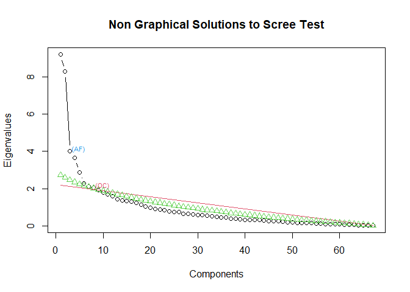
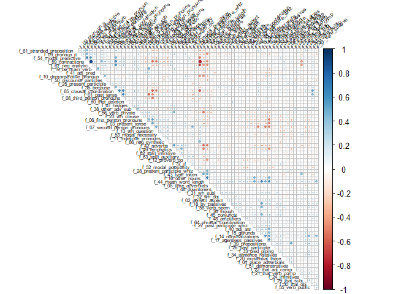
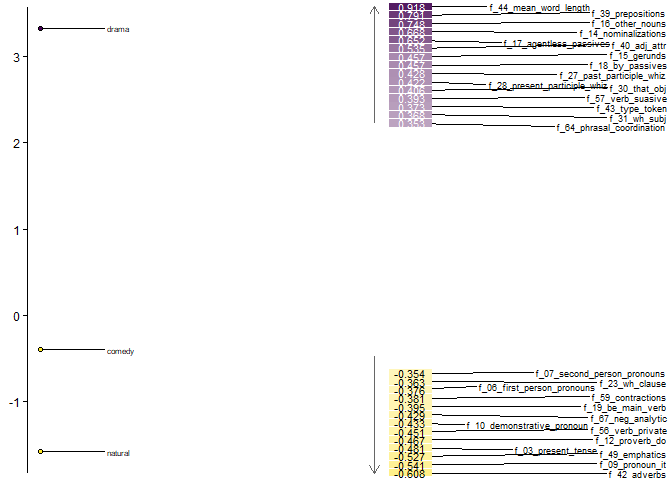

# Dramaticity Pipeline
Zach Shultz
2026-11-06

## EXISTING piepline

This pipeline was used for progress report 2, it has been updated to
reflect the final analysis

## Prereqs

In addition to tidyverse packages, `corrplot`, `mda.biber`, `spacyr`,
`udpipe`, and `quanteda` will all need to be installed.

Additionally, an installation of python (3.10+) is required to utilize
spaCy R. Once these are installed, everything can be completed within R
as described below.

[Information on spaCy](https://spacy.io/usage)

``` r
library(tidyverse)
```

    ── Attaching core tidyverse packages ──────────────────────── tidyverse 2.0.0 ──
    ✔ dplyr     1.2.1     ✔ readr     2.2.0
    ✔ forcats   1.0.1     ✔ stringr   1.6.0
    ✔ ggplot2   4.0.3     ✔ tibble    3.3.1
    ✔ lubridate 1.9.5     ✔ tidyr     1.3.2
    ✔ purrr     1.2.2     
    ── Conflicts ────────────────────────────────────────── tidyverse_conflicts() ──
    ✖ dplyr::filter() masks stats::filter()
    ✖ dplyr::lag()    masks stats::lag()
    ℹ Use the conflicted package (<http://conflicted.r-lib.org/>) to force all conflicts to become errors

``` r
library(corrplot)
```

    corrplot 0.95 loaded

``` r
library(lme4)
```

    Loading required package: Matrix

    Attaching package: 'Matrix'

    The following objects are masked from 'package:tidyr':

        expand, pack, unpack

``` r
library(mda.biber)
library(spacyr)
```

    Warning: package 'spacyr' was built under R version 4.6.2

``` r
library(quanteda)
```

    Warning: package 'quanteda' was built under R version 4.6.2

    Package version: 4.5.1
    Unicode version: 15.1
    ICU version: 74.1
    Parallel computing: 8 of 8 threads used.
    See https://quanteda.io for tutorials and examples.

``` r
library(udpipe)
```

    Warning: package 'udpipe' was built under R version 4.6.2

``` r
library(pseudobibeR)
```

    Warning: package 'pseudobibeR' was built under R version 4.6.2

## Intro

This pipeline describes the process of completing the MDA. See the
[Santa Barbara Pipeline](santa_barbara_pipeline.md) and the [Scraps from
the Loft Pipeline](scraps_from_loft_pipeline.md) for information on how
the component data frames were assembled and where the data came from.

This document is used to describe how the individual data frames were
combined, the shape of the resulting data frame, and the steps of the
analysis. Finally, it will briefly go over the results. If more details
are needed to explain the steps of the MDA, see the [MDA
document](mda.md). Final results and exploration of the analysis is
documented in the [Dramaticity Analysis](final_report.md) document.

## Creating all_transcripts DF

First, we load in the `tv_show_transcripts` pipeline as a csv.

``` r
tv_show_df <- read.csv("private/tv_show_transcripts.csv")

tv_show_df
```

Then, we can load in the SB data frame.

``` r
sb_files <- read.csv("private/sb_files.csv")

sb_files
```

Finally, we combine the two data frames.

``` r
all_transcripts <- rbind(sb_files, tv_show_df)

all_transcripts <- all_transcripts|>
  #renaming the first column to id and the second column to text as that is what is expected for the pseudobiber pipeline below
  rename(text = "clean_words",
         doc_id = "id")
```

Now we save this file to our private folder!

``` r
write_csv(all_transcripts, "private/all_transcripts.csv")
```

## Summary `all_transcripts`

Below is some summary information about what is included in
all_transcripts:

Number of rows and columns in our df and breakdown of genre

``` r
nrow(all_transcripts)
```

    [1] 120

``` r
ncol(all_transcripts)
```

    [1] 2

``` r
all_transcripts |>
  mutate(doc_id = case_when(str_detect(doc_id, "trn") ~ "natural", 
                        str_detect(doc_id, "comedy") ~ "comedy", 
                        str_detect(doc_id, "drama") ~ "drama")) |>
  mutate(nwords = (str_count(text, "\\w+"))) |>
  count(doc_id)
```

       doc_id  n
    1  comedy 28
    2   drama 32
    3 natural 60

Approximate number of words in our df:

``` r
all_transcripts |>
  mutate(nwords = (str_count(text, "\\w+"))) |>
  summarize(sum(nwords))
```

      sum(nwords)
    1      538942

Approximate number of words by category:

``` r
all_transcripts |>
  mutate(doc_id = case_when(str_detect(doc_id, "trn") ~ "natural", 
                        str_detect(doc_id, "comedy") ~ "comedy", 
                        str_detect(doc_id, "drama") ~ "drama")) |>
  mutate(nwords = (str_count(text, "\\w+"))) |>
  group_by(doc_id) |>
  summarize(sum(nwords))
```

    # A tibble: 3 × 2
      doc_id  `sum(nwords)`
      <chr>           <int>
    1 comedy         116947
    2 drama          158660
    3 natural        263335

## Tagging all_transcripts and Getting Factor Loadings

In order to parse the data, it is necessary to use spaCy to tag all of
the words in the document. Then, an R package called `pseudobibeR` can
be used to get the 67 linguistic features created by Biber. For more
details on the process, see
[here](https://github.com/browndw/pseudobibeR). Note that this package
and the following were created by David Brown, a linguist at CMU!

First, we can ensure that all texts are normalized and in a corpus
format. A glimpse of the corpus format can be seen below.

``` r
# 1. Read the texts and normalize typographic quotes (’ -> ')
all_transcripts$clean_words <- utf8::utf8_normalize(all_transcripts$clean_words, map_quote = TRUE)
corp <- corpus(all_transcripts)

corp
```

Next, we will download an English parsing model through `udpipe`. This
is essentially a wrapper that allows R users to run tagging and parsing.

``` r
# 2. Parse with udpipe (the model is downloaded once)
model <- udpipe_download_model(language = "english")
```

    Downloading udpipe model from https://raw.githubusercontent.com/jwijffels/udpipe.models.ud.2.5/master/inst/udpipe-ud-2.5-191206/english-ewt-ud-2.5-191206.udpipe to C:/Users/justz/Dramaticity-Multidimensional-Analysis/english-ewt-ud-2.5-191206.udpipe

     - This model has been trained on version 2.5 of data from https://universaldependencies.org

     - The model is distributed under the CC-BY-SA-NC license: https://creativecommons.org/licenses/by-nc-sa/4.0

     - Visit https://github.com/jwijffels/udpipe.models.ud.2.5 for model license details.

     - For a list of all models and their licenses (most models you can download with this package have either a CC-BY-SA or a CC-BY-SA-NC license) read the documentation at ?udpipe_download_model. For building your own models: visit the documentation by typing vignette('udpipe-train', package = 'udpipe')

    Downloading finished, model stored at 'C:/Users/justz/Dramaticity-Multidimensional-Analysis/english-ewt-ud-2.5-191206.udpipe'

Once the above code has been run once, only the below code will be
necessary to load in the model as below.

``` r
ud_model <- udpipe_load_model(model$file_model)
```

And parse each character in the corpus. This process takes some time,
around ten minutes.

``` r
parsed <- udpipe_annotate(ud_model, x = as.character(corp), doc_id = docnames(corp), trace = 100)
```

    2026-11-19 11:41:36.019404 Annotating text fragment 1/120
    2026-11-19 11:50:13.012655 Annotating text fragment 101/120

Finally, we can get the feature weights which will be used in the second
half of functions. This function also takes some time to run, about 2-3
minutes.

``` r
# 3. Count the features: one row per document
features <- biber(parsed)
```

## Getting Dimension Scores

As can be seen in the `features` data structure, we have feature counts
for each text. These can now be run through another series of functions
to get the overall feature scores for the 67 linguistic features for
each text and dimension scores.

Once read in, the process described
[here](https://cran.r-project.org/web/packages/mda.biber/vignettes/introduction.html)
is used to run our first attempt at the MDA. This is the second half of
David Brown’s pipeline!

Note that the documents are being renamed below such that each
individual file is represented by it’s category and no other
information. For instance, each comedy TV show will only be known as
comedy. This is necessary since we are comparing the groups as a whole.

``` r
#ok so first we are assigning our data set to the variable d
d <- features |>
  #then, we are modifying a column called doc_id to rename columns that contain either "comedy", "drama" or "trn" with "comedy", "drama", and "natural". 
  mutate(doc_id = case_when(str_detect(doc_id, "comedy") ~ "comedy",
                            str_detect(doc_id, "drama") ~ "drama",
                            str_detect(doc_id, "trn") ~ "natural")) |>
  #then we are modifying our new column so the strings are factors
  mutate(doc_id = as.factor(doc_id)) |>
  #removes the columns with values = 0
  select(where(~ any(. != 0)))
```

This changes the labels of the id column so that our groups are formed,
turns them into factors, and removes any columns with 0 instances. Any
features not observed should not be there to run a proper mda as below.

## Determining Ideal Number of Factors

The next step in the analysis is to decide on how many factors should be
formed from the factor loadings. See the [MDA](mda.md) document for more
details on this important decision.

``` r
screeplot_mda(d)
```



A screeplot displays ‘eigenvalues’. Simply put, it groups feature
weights based on their impact on the data. Large feature loadings will
therefore be grouped together, medium feature loadings grouped together,
and so on.

The ‘elbow’ is a term used to describe the cut off point where the
features being grouped are not particularly impactful in terms of their
predictive power. Visually, it is where the line becomes less steep.
Anything at or below the elbow is considered ‘scree’.

In this case, we have decided to use the AF (accelerated factor) value
to determine the elbow. This is a mathematical measure of where the line
first begins to curve. Since there are two points above that, we should
include two factors. Note that there is no easy way to determine the
elbow or how many dimensions to include. If it is found that more
dimensions might better suit an understanding of the data, re-analysis
should be done.

In order to be sure that an MDA is worth running, we want to see that
there is high correlation and inverse correlation among textual
features. While this step is expected for textual features, it is still
nice to run to be sure.

``` r
cor_m <- cor(d[,-1], method = "pearson")

corrplot(cor_m, type = "upper", order = "hclust", tl.col = "black", tl.srt = 45, diag = F, tl.cex = 0.5)
```



As we can see, there are multiple areas of dark blue (high correlation)
and dark red (high inverse correlation). Therefore, we know that a
multidimensional analysis makes sense for these groups.

## Running the MDA

Next we are running the MDA. Essentially, we are getting mean scores for
the significant feature loadings within each dimension (\>.35).

``` r
#now for the actual mda, factors is set equal to 2 because of the screeplot results
m <- mda_loadings(d, n_factors = 2)
```

And below we can see these mean values:

``` r
dimension_scores <- attributes(m)$group_means

dimension_scores
```

        group    Factor1    Factor2
    1  comedy -0.4063865  -9.641276
    2   drama  3.3317098 -10.431191
    3 natural -1.5872649  10.062564

Immediately, we can see a substantial difference between Factor 1 and
Factor 2. While Drama scores quite distinctly from the other two groups
in Factor 1, Natural language is quite different along Factor 2. A
deeper analysis of the differences between these two factors will likely
lead to a better understanding of where dramaticity comes into play.
These differences can be even better visualized in graphic form.

Below are the highest correlation features by factor.

``` r
#values arranged in descending order for factor 1
attributes(m)$loadings |> arrange(-Factor1)
```

                                      Factor1      Factor2
    f_44_mean_word_length         0.917618683 -0.360802002
    f_39_prepositions             0.791399304  0.176947204
    f_16_other_nouns              0.748254730 -0.400875028
    f_14_nominalizations          0.668069450  0.026803782
    f_17_agentless_passives       0.652140966  0.158139788
    f_40_adj_attr                 0.535292769  0.036751431
    f_15_gerunds                  0.456882193  0.253837040
    f_18_by_passives              0.456834204 -0.002041751
    f_27_past_participle_whiz     0.428333154 -0.057529408
    f_28_present_participle_whiz  0.421854336 -0.178714748
    f_30_that_obj                 0.406312093  0.182779904
    f_57_verb_suasive             0.392510387 -0.126766285
    f_43_type_token               0.373395321 -0.838171465
    f_31_wh_subj                  0.367766821 -0.045063332
    f_64_phrasal_coordination     0.353303743  0.055260912
    f_24_infinitives              0.327228387 -0.412768308
    f_45_conjuncts                0.322435739  0.234700410
    f_33_pied_piping              0.305824834  0.020338677
    f_58_verb_seem                0.296388502 -0.054801585
    f_48_amplifiers               0.295017432  0.114399157
    f_51_demonstratives           0.288850149  0.253337597
    f_02_perfect_aspect           0.283695567  0.074398452
    f_34_sentence_relatives       0.283148561  0.217833253
    f_29_that_subj                0.273647844  0.291568829
    f_46_downtoners               0.192475692 -0.170725465
    f_25_present_participle       0.154381675  0.271978489
    f_35_because                  0.154312612  0.318664952
    f_21_that_verb_comp           0.144451039 -0.011941679
    f_36_though                   0.127147886  0.037291234
    f_26_past_participle          0.112072595  0.140841952
    f_04_place_adverbials         0.111449825  0.118718972
    f_22_that_adj_comp            0.097361555 -0.038181857
    f_32_wh_obj                   0.064389971 -0.029730654
    f_55_verb_public              0.057120722  0.342155527
    f_66_neg_synthetic            0.019475331 -0.479669445
    f_05_time_adverbials          0.017507458 -0.185546942
    f_20_existential_there        0.009851697  0.337927838
    f_13_wh_question             -0.004481128 -0.563142311
    f_08_third_person_pronouns   -0.005091207  0.500619007
    f_01_past_tense              -0.021035373  0.403098489
    f_61_stranded_preposition    -0.028852035  0.498928687
    f_37_if                      -0.047710458  0.147853883
    f_11_indefinite_pronouns     -0.049247142 -0.428642155
    f_38_other_adv_sub           -0.128933866  0.385413333
    f_65_clausal_coordination    -0.132609072  0.777277681
    f_52_modal_possibility       -0.166501222 -0.332124811
    f_54_modal_predictive        -0.168822569  0.694750479
    f_53_modal_necessity         -0.169149744 -0.311903312
    f_62_split_infinitive        -0.199071203  0.085987104
    f_60_that_deletion           -0.225973758 -0.063755179
    f_47_hedges                  -0.226526286  0.128512201
    f_41_adj_pred                -0.248509296 -0.023267464
    f_63_split_auxiliary         -0.262795443  0.011070538
    f_50_discourse_particles     -0.341846003  0.370582994
    f_07_second_person_pronouns  -0.353892475 -0.680125719
    f_23_wh_clause               -0.362788105 -0.239553756
    f_06_first_person_pronouns   -0.376132258 -0.410485975
    f_59_contractions            -0.380857719  0.974338873
    f_19_be_main_verb            -0.395226274  0.292347414
    f_67_neg_analytic            -0.428958862  0.874282781
    f_10_demonstrative_pronoun   -0.433313176  0.394149240
    f_56_verb_private            -0.451254882  0.245920545
    f_12_proverb_do              -0.467222976  0.069600491
    f_03_present_tense           -0.481098596 -0.182900850
    f_49_emphatics               -0.526833942  0.108207461
    f_09_pronoun_it              -0.540570268  0.388947622
    f_42_adverbs                 -0.607777476  0.297992314

``` r
#values arranged in descending order for factor 1
#note that m contains the raw values while specifying loadings gets us the values normalized around 0
attributes(m)$loadings |> arrange(-Factor2)
```

                                      Factor1      Factor2
    f_59_contractions            -0.380857719  0.974338873
    f_67_neg_analytic            -0.428958862  0.874282781
    f_65_clausal_coordination    -0.132609072  0.777277681
    f_54_modal_predictive        -0.168822569  0.694750479
    f_08_third_person_pronouns   -0.005091207  0.500619007
    f_61_stranded_preposition    -0.028852035  0.498928687
    f_01_past_tense              -0.021035373  0.403098489
    f_10_demonstrative_pronoun   -0.433313176  0.394149240
    f_09_pronoun_it              -0.540570268  0.388947622
    f_38_other_adv_sub           -0.128933866  0.385413333
    f_50_discourse_particles     -0.341846003  0.370582994
    f_55_verb_public              0.057120722  0.342155527
    f_20_existential_there        0.009851697  0.337927838
    f_35_because                  0.154312612  0.318664952
    f_42_adverbs                 -0.607777476  0.297992314
    f_19_be_main_verb            -0.395226274  0.292347414
    f_29_that_subj                0.273647844  0.291568829
    f_25_present_participle       0.154381675  0.271978489
    f_15_gerunds                  0.456882193  0.253837040
    f_51_demonstratives           0.288850149  0.253337597
    f_56_verb_private            -0.451254882  0.245920545
    f_45_conjuncts                0.322435739  0.234700410
    f_34_sentence_relatives       0.283148561  0.217833253
    f_30_that_obj                 0.406312093  0.182779904
    f_39_prepositions             0.791399304  0.176947204
    f_17_agentless_passives       0.652140966  0.158139788
    f_37_if                      -0.047710458  0.147853883
    f_26_past_participle          0.112072595  0.140841952
    f_47_hedges                  -0.226526286  0.128512201
    f_04_place_adverbials         0.111449825  0.118718972
    f_48_amplifiers               0.295017432  0.114399157
    f_49_emphatics               -0.526833942  0.108207461
    f_62_split_infinitive        -0.199071203  0.085987104
    f_02_perfect_aspect           0.283695567  0.074398452
    f_12_proverb_do              -0.467222976  0.069600491
    f_64_phrasal_coordination     0.353303743  0.055260912
    f_36_though                   0.127147886  0.037291234
    f_40_adj_attr                 0.535292769  0.036751431
    f_14_nominalizations          0.668069450  0.026803782
    f_33_pied_piping              0.305824834  0.020338677
    f_63_split_auxiliary         -0.262795443  0.011070538
    f_18_by_passives              0.456834204 -0.002041751
    f_21_that_verb_comp           0.144451039 -0.011941679
    f_41_adj_pred                -0.248509296 -0.023267464
    f_32_wh_obj                   0.064389971 -0.029730654
    f_22_that_adj_comp            0.097361555 -0.038181857
    f_31_wh_subj                  0.367766821 -0.045063332
    f_58_verb_seem                0.296388502 -0.054801585
    f_27_past_participle_whiz     0.428333154 -0.057529408
    f_60_that_deletion           -0.225973758 -0.063755179
    f_57_verb_suasive             0.392510387 -0.126766285
    f_46_downtoners               0.192475692 -0.170725465
    f_28_present_participle_whiz  0.421854336 -0.178714748
    f_03_present_tense           -0.481098596 -0.182900850
    f_05_time_adverbials          0.017507458 -0.185546942
    f_23_wh_clause               -0.362788105 -0.239553756
    f_53_modal_necessity         -0.169149744 -0.311903312
    f_52_modal_possibility       -0.166501222 -0.332124811
    f_44_mean_word_length         0.917618683 -0.360802002
    f_16_other_nouns              0.748254730 -0.400875028
    f_06_first_person_pronouns   -0.376132258 -0.410485975
    f_24_infinitives              0.327228387 -0.412768308
    f_11_indefinite_pronouns     -0.049247142 -0.428642155
    f_66_neg_synthetic            0.019475331 -0.479669445
    f_13_wh_question             -0.004481128 -0.563142311
    f_07_second_person_pronouns  -0.353892475 -0.680125719
    f_43_type_token               0.373395321 -0.838171465

If we consider Drama TV shows to generally have language that is more
exaggerated compared to comedy TV shows and real life, then we could
posit that dimension 1 is more likely to reflect the dimension of
dramaticity. It is likely that dimension 2, then, more reflects
differences between natural discourse and TV show discourse that are
shared between the drama and comedy genre. A further analysis of the
specific features involved will likely support this.

Given this hypothesis, for now we will focus on dimension 1.

``` r
#mapping the mean dimension scores centered around 0
stickplot_mda(m, n_factor = 1)
```


This graph is a useful tool for understanding what the dimension
analysis does. Based on the mean scores we saw earlier, the graph places
all groups around 0. Since scores are averaged around 0, it is very easy
to see how the different groups are on opposite ends of the spectrum for
this dimension.

``` r
heatmap_mda(m, n_factor = 1)
```

    Registered S3 method overwritten by 'car':
      method           from
      na.action.merMod lme4



By including the relevant features, things become even clearer. One
important reminder is that highly positive and highly negative features
(such as mean word length and adverbs) are in a trade off relationship.
Among these groups, as the mean length of a word increases we would
expect fewer adverbs to be present and vice versa.

Two immediate thoughts based on this graph:

- it is suprising that emphatics are less likely to occur in drama TV
  show transcripts

- it is surprising that adverbs are also so unlikely in drama TV show
  transcripts

It will be important to sample some of the tags for these documents to
better understand what is causing these rates. What sorts of words are
being tagged as adverbs so frequently in the SB files?

## Linear Mixed Effect Model

A good next step in the analysis is to determine whether these groupings
are significantly different along their dimensions. In other words, how
well do the dimensions and their features predict a given group.

## Considering Relevant Features

Assuming Dimension one is more fitting for dramaticity, relevant
features that may have to do with dramaticity based on these results:

High presence of: -mean word length, prepositions, other nouns,
nominalizations

Low presence of: -adverbs, pronoun it, emphatics, present tense, proverb
do

Samples of the text:

``` r
sessionInfo()
```

    R version 4.6.1 (2026-06-24 ucrt)
    Platform: x86_64-w64-mingw32/x64
    Running under: Windows 11 x64 (build 26200)

    Matrix products: default
      LAPACK version 3.12.1

    locale:
    [1] LC_COLLATE=English_United States.utf8 
    [2] LC_CTYPE=English_United States.utf8   
    [3] LC_MONETARY=English_United States.utf8
    [4] LC_NUMERIC=C                          
    [5] LC_TIME=English_United States.utf8    

    time zone: America/New_York
    tzcode source: internal

    attached base packages:
    [1] stats     graphics  grDevices utils     datasets  methods   base     

    other attached packages:
     [1] pseudobibeR_1.3 udpipe_0.8.16   quanteda_4.5.1  spacyr_1.4.0   
     [5] mda.biber_1.0.1 lme4_2.0-6      Matrix_1.7-5    corrplot_0.95  
     [9] lubridate_1.9.5 forcats_1.0.1   stringr_1.6.0   dplyr_1.2.1    
    [13] purrr_1.2.2     readr_2.2.0     tidyr_1.3.2     tibble_3.3.1   
    [17] ggplot2_4.0.3   tidyverse_2.0.0

    loaded via a namespace (and not attached):
     [1] tidyselect_1.2.1          viridisLite_0.4.3        
     [3] farver_2.1.2              viridis_0.6.5            
     [5] S7_0.2.2                  fastmap_1.2.0            
     [7] digest_0.6.39             timechange_0.4.0         
     [9] lifecycle_1.0.5           magrittr_2.0.5           
    [11] compiler_4.6.1            rlang_1.3.0              
    [13] tools_4.6.1               utf8_1.2.6               
    [15] yaml_2.3.12               data.table_1.18.6.1      
    [17] knitr_1.51                ggsignif_0.6.4           
    [19] labeling_0.4.3            stopwords_2.3            
    [21] bit_4.6.0                 RColorBrewer_1.1-3       
    [23] abind_1.4-8               withr_3.0.3              
    [25] grid_4.6.1                ggpubr_1.0.0             
    [27] scales_1.4.0              MASS_7.3-65              
    [29] cli_3.6.6                 rmarkdown_2.31           
    [31] crayon_1.5.3              reformulas_0.4.4         
    [33] nFactors_2.4.1.2          generics_0.1.4           
    [35] otel_0.2.0                rstudioapi_0.19.0        
    [37] tzdb_0.5.0                minqa_1.2.8              
    [39] splines_4.6.1             parallel_4.6.1           
    [41] vctrs_0.7.3               boot_1.3-32              
    [43] jsonlite_2.0.0            carData_3.0-6            
    [45] car_3.1-5                 hms_1.1.4                
    [47] bit64_4.8.4               ggrepel_0.9.8            
    [49] rstatix_1.1.0             Formula_1.2-6            
    [51] quanteda.textstats_0.97.2 glue_1.8.1               
    [53] nloptr_2.2.1              cowplot_1.2.0            
    [55] stringi_1.8.9             gtable_0.3.6             
    [57] pillar_1.11.1             htmltools_0.5.9          
    [59] R6_2.6.1                  Rdpack_2.6.6             
    [61] vroom_1.7.1               evaluate_1.0.5           
    [63] lattice_0.22-9            rbibutils_2.4.1          
    [65] backports_1.5.1           broom_1.0.13             
    [67] Rcpp_1.1.2                fastmatch_1.1-8          
    [69] nsyllable_1.0.1           gridExtra_2.3.1          
    [71] nlme_3.1-169              xfun_0.60                
    [73] pkgconfig_2.0.3          
